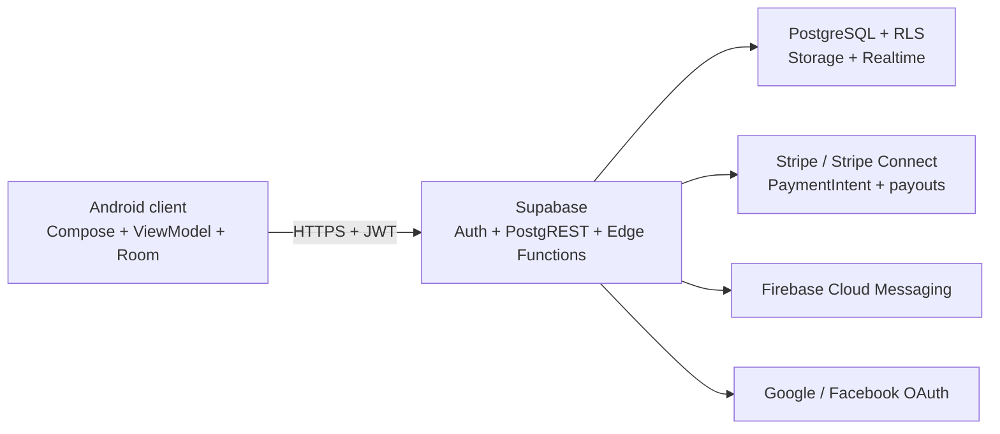
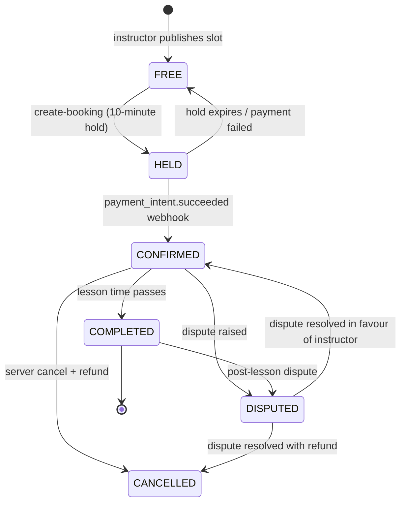
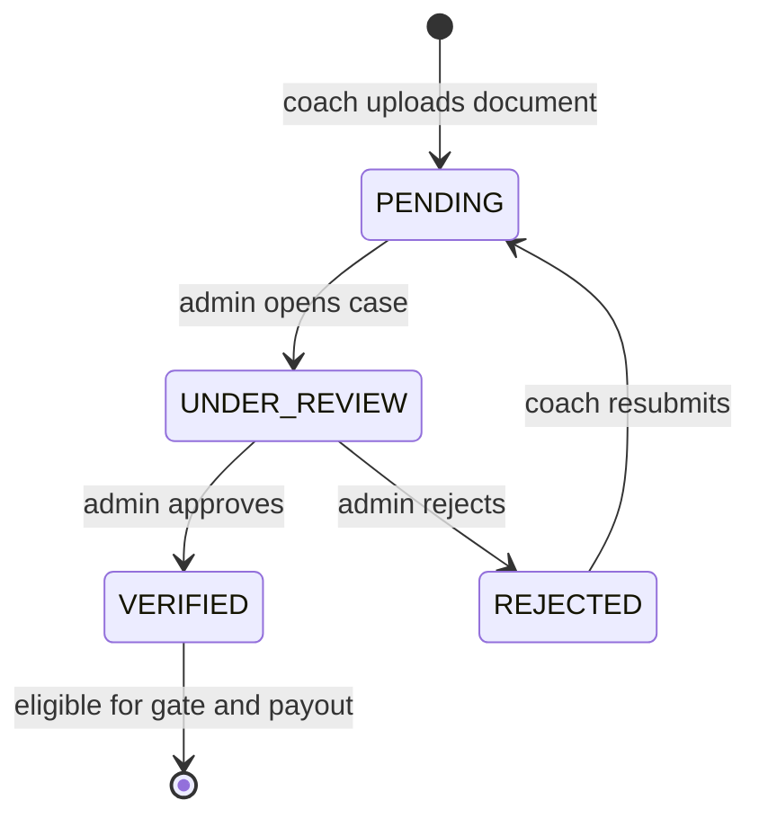

# MoMA — Software Requirements Specification (SRS)

| Field | Value |
|---|---|
| Product | MoMA Android application and supporting backend |
| Document version | 1.0 |
| Status | Proposed for implementation approval |
| Baseline | PRD v1.0; Assignment2.pdf; MoMA_Android_App_Design.md; MoMA_Android_Solution.html |
| Related documents | PRD, UX/UI Design Specs, SAD, DDD, API Documentation |
| Requirement ID scheme | `FR-<AREA>-<nn>`, `NFR-<AREA>-<nn>`, `BR-<nn>` |

> **Status tags:** **[Brief]** from the assignment PDF; **[Design]** from the supplied design/solution artefacts; **[Proposed]** newly specified here and subject to approval. Numeric performance/uptime targets are proposed engineering targets, not measured values.

---

## 1. Introduction

### 1.1 Purpose

This SRS specifies what the MoMA system must do (functional requirements) and how well it must do it (non-functional requirements). It is the contract between product intent (PRD) and architecture/design (SAD, DDD, UX specs) and the basis for test cases and acceptance.

### 1.2 Scope

MoMA comprises:

1. An **Android client** (Kotlin, Jetpack Compose, Material 3) with MVVM + Clean Architecture and Room/SQLite as local source of truth.
2. A **Supabase backend**: Auth (GoTrue), PostgREST over PostgreSQL with RLS, Storage, Edge Functions and optional Realtime.
3. **Third-party integrations**: Stripe + Stripe Connect for payments/payouts, Firebase Cloud Messaging for push, Google/Facebook OAuth.

Out of scope is defined in PRD §5 and applies here in full.

### 1.3 Definitions

| Term | Meaning |
|---|---|
| Role | `STUDENT`, `INSTRUCTOR`, `ADMIN`; plus the gym owner/program-manager persona, implemented as an instructor-scoped gym capability **[Design]** |
| Slot state | `FREE` → `HELD` (10 minutes) → `BOOKED`; or released to `FREE` on expiry |
| Booking state | `PENDING_PAYMENT` → `CONFIRMED` → `COMPLETED` / `CANCELLED` / `DISPUTED` |
| Credential gate | Mandatory pre-scoring check that a coach holds the verified credential and ruleset experience required by a gym requirement |
| Outbox | Local table of offline mutations carrying an idempotency key, replayed by WorkManager |
| Server-authoritative | Only Edge Functions/database may change booking, payment, payout and verification state |

### 1.4 System context

### 1.5 Operating environment

- Android API 26+; latest stable compile/target SDK; Kotlin 2.x; Compose BOM **[Design]**.
- Network: HTTPS only; offline-capable reads; payment and search require connectivity.
- Local storage: Room/SQLite with foreign keys enabled and versioned migrations.
- Server: managed Supabase project; no self-operated server in the assignment scope.

### 1.6 Constraints and assumptions

- Stripe is the only card processor; card details never enter MoMA systems.
- Public anon key may ship in the app; **RLS is the security boundary**; service-role and Stripe secret keys are used only in Edge Functions **[Design]**.
- First release covers six styles: BJJ Gi, BJJ No-Gi, Judo, Wrestling, Kyokushin Karate, Muay Thai; ruleset tags ADCC and ACBJJ Battle Jiu-Jitsu **[Design]**.
- Currency is MYR; personal data handling aligns with Malaysia PDPA **[Design]**.

---

## 2. Functional requirements

### 2.1 Authentication and session (FR-AUTH)

| ID | Requirement | Priority | Source |
|---|---|---|---|
| FR-AUTH-01 | The system shall allow registration with full name, phone, email and password, with client-side field validation and a privacy notice acceptance step | Must | Brief p.4 |
| FR-AUTH-02 | The system shall support Google and Facebook sign-in | Must | Brief p.4 |
| FR-AUTH-03 | The system shall authenticate email/password via Supabase Auth and return a JWT + refresh token | Must | Design §7 |
| FR-AUTH-04 | The system shall store access/refresh tokens in Keystore-backed storage and clear them on logout | Must | Design §8 |
| FR-AUTH-05 | The system shall restore a valid session after app restart and skip onboarding | Must | Design §11 |
| FR-AUTH-06 | The system shall send a password-recovery email and display a neutral success message regardless of account existence | Must | Brief p.4; Design §5 |
| FR-AUTH-07 | The system shall route the user after sign-in based on the role claim | Must | Design §5 |
| FR-AUTH-08 | The system shall deny protected destinations when the role claim does not permit them | Must | Design §5, §8 |

### 2.2 Profiles and portfolios (FR-PROF)

| ID | Requirement | Priority | Source |
|---|---|---|---|
| FR-PROF-01 | The system shall create a user profile row on successful registration | Must | Design §7 |
| FR-PROF-02 | A user shall be able to view and edit their own profile (name, bio, contact, city, avatar) | Must | Brief p.5 |
| FR-PROF-03 | An instructor shall be able to maintain a public portfolio: styles, experience, qualifications, hourly rate, rating summary, media | Must | Brief p.5; Design §6 |
| FR-PROF-04 | Profile edits made offline shall be stored locally and queued with an idempotency key | Must | Design §6.4 |
| FR-PROF-05 | The system shall display a verification badge only when all required credentials are admin-approved | Must | Design (gym scope) |
| FR-PROF-06 | No password, card data or secrets shall be stored in Room/SQLite | Must | Design §8, §11 |

### 2.3 Catalogue, listings and content (FR-CAT)

| ID | Requirement | Priority | Source |
|---|---|---|---|
| FR-CAT-01 | The system shall expose a style catalogue; release 1 exposes exactly the six focus styles | Must | Brief p.6; Design gym scope |
| FR-CAT-02 | An instructor shall be able to create, edit and deactivate a lesson listing with title, style, ruleset, level, duration, price, city and description | Must | Brief p.6; Design §5 |
| FR-CAT-03 | Listings shall only be editable by their owner, enforced by RLS | Must | Design §8 |
| FR-CAT-04 | The app shall render a coach/instructor detail screen with hero image, price, description, availability, credentials, rating and reviews | Must | Brief p.6 |
| FR-CAT-05 | A gym owner shall be able to publish and edit a Mon–Sun curriculum with style and ruleset per day | Must (beachhead) | Design gym scope |
| FR-CAT-06 | A gym owner shall be able to post a coach requirement with program day, required credential, ruleset and budget | Must (beachhead) | Design gym scope |

### 2.4 Search, discovery and matching (FR-DISC)

| ID | Requirement | Priority | Source |
|---|---|---|---|
| FR-DISC-01 | The system shall provide a search bar accepting style, location, coach name and availability keywords | Must | Brief p.7 |
| FR-DISC-02 | The system shall provide debounced autocomplete suggestions after two or more characters | Must | Brief p.7; Design §5 |
| FR-DISC-03 | The system shall support filters for style, city, price, rating, availability, verified credential and ruleset | Must | Brief p.7; Design gym scope |
| FR-DISC-04 | Online results shall be cached into Room; when offline the app shall show cached results with a "saved data" banner | Must | Design §6.4 |
| FR-DISC-05 | The system shall rank instructors using: style 30%, availability 25%, distance 15%, rating/review quality 15%, price fit 10%, verification/response 5% | Should | Design §7.4 |
| FR-DISC-06 | Before scoring, the system shall exclude coaches who do not satisfy the mandatory verified-credential and ruleset gate | Must | Design gym scope |
| FR-DISC-07 | The UI shall display the score factor breakdown for each match | Should | Design §5, §7.4 |

### 2.5 Availability, booking and payment (FR-BOOK)

| ID | Requirement | Priority | Source |
|---|---|---|---|
| FR-BOOK-01 | The system shall display availability slots in `FREE`, `HELD` and `BOOKED` states with the applicable ruleset | Must | Brief p.9; Design §5 |
| FR-BOOK-02 | `create-booking` shall atomically check the slot, set it to `HELD` and create a pending booking in one transaction | Must | Design §7.5 |
| FR-BOOK-03 | The system shall create a Stripe PaymentIntent with `application_fee_amount` equal to the server-resolved 10–20% commission | Must | Brief revenue; Design §7.5 |
| FR-BOOK-04 | The client shall confirm the PaymentIntent through the Stripe Android SDK; no PAN/CVV shall be sent to MoMA endpoints | Must | Design §7.5, §8 |
| FR-BOOK-05 | On `payment_intent.succeeded`, the system shall set booking `CONFIRMED`, slot `BOOKED` and schedule a Stripe Connect payout | Must | Design §7.6 |
| FR-BOOK-06 | Held slots shall be released after 10 minutes if payment is not completed | Must | Design §7.5 |
| FR-BOOK-07 | The app shall present a 4-step checkout: Lesson → Slot → Payment → Review, with an order summary and visible service fee | Must | Brief p.9; Design §5 |
| FR-BOOK-08 | Local booking state shall be shown as pending until server confirmation arrives; conflicts resolve in favour of the server | Must | Design §4.2, §6.4 |
| FR-BOOK-09 | A user shall see bookings grouped as Upcoming / Completed / Cancelled with status chips and contextual actions | Must | Design §5 |
| FR-BOOK-10 | The system shall cancel a booking and apply refund rules server-side only | Should | Design §7.5 |
| FR-BOOK-11 | The confirmed booking shall store the ruleset (Gi/No-Gi, ADCC, ACBJJ Battle Jiu-Jitsu, open mat) and program day | Must (beachhead) | Design gym scope |
| FR-BOOK-12 | Booking and payment operations shall require network connectivity | Must | Design §6.4 |

### 2.6 Ratings and reviews (FR-REV)

| ID | Requirement | Priority | Source |
|---|---|---|---|
| FR-REV-01 | A student may submit a review only for a `COMPLETED` booking for the same student/instructor pair | Must | Brief p.10; Design §7.5 |
| FR-REV-02 | The composer shall support a 1–5 star rating, quick tags, text and optional image/video | Must | Brief p.10 |
| FR-REV-03 | The system shall enforce one review per booking (unique `booking_id`) | Must | Design §6.1 |
| FR-REV-04 | Media uploads shall be queued locally and retried by WorkManager with allowlisted MIME types and size limits | Must | Design §8 |
| FR-REV-05 | A dispute may block review submission until resolution | Should | Design §5 |

### 2.7 Community (FR-COM)

| ID | Requirement | Priority | Source |
|---|---|---|---|
| FR-COM-01 | Users shall be able to browse suggested, joined and nearby groups and join/leave groups | Should | Brief p.8 |
| FR-COM-02 | Members shall be able to create posts with text/media, comments and likes | Should | Brief p.8 |
| FR-COM-03 | The app shall provide optimistic UI with local drafts and outbox replay for posts, comments and likes | Should | Design §6.4 |
| FR-COM-04 | Feed content shall be visible only to group members, enforced by RLS | Must | Brief p.8; Design §8 |
| FR-COM-05 | Group rules and member list shall be visible in the feed | Should | Brief p.8 |

### 2.8 Analytics and reporting (FR-ANA)

| ID | Requirement | Priority | Source |
|---|---|---|---|
| FR-ANA-01 | The dashboard shall show sessions, duration, intensity and calorie/steps-style widgets for Today / Week / Month | Should | Brief p.11; Design §5 |
| FR-ANA-02 | Users shall be able to toggle and reorder dashboard widgets | Could | Brief p.11 |
| FR-ANA-03 | Instructors/admins shall see server-generated sales aggregates (gross, commission, trends, payout summary) | Should | Brief p.12; Design §5 |
| FR-ANA-04 | No raw payment data shall be delivered to the client for reporting | Must | Design §5 |

### 2.9 Trust, safety and support (FR-TRU)

| ID | Requirement | Priority | Source |
|---|---|---|---|
| FR-TRU-01 | A user shall be able to raise a dispute for a booking with reason, details and evidence | Should | Brief p.10 |
| FR-TRU-02 | A user shall be able to report a user or content with one of the seven defined reasons and details | Should | Brief p.12 |
| FR-TRU-03 | A user shall be able to submit a support ticket with subject, issue, image, email and phone, and see email/phone/chat contact options | Must | Brief p.13 |
| FR-TRU-04 | Disputes, reports and support tickets shall be submittable offline and synced later | Must | Design §11 |
| FR-TRU-05 | Only admins may change dispute/report/credential status; decisions shall be auditable | Must | Design §8 |
| FR-TRU-06 | An admin console shall show verification, dispute, moderation and payout queues | Should | Design §5 |

### 2.10 Notifications (FR-NOT)

| ID | Requirement | Priority | Source |
|---|---|---|---|
| FR-NOT-01 | The system shall send push notifications for booking confirmation, payment status, dispute updates and forum activity | Should | Design §3, §7.6 |
| FR-NOT-02 | Notifications shall deep-link to the relevant screen | Should | Design §6.1 |
| FR-NOT-03 | Notification permission shall be requested just-in-time | Must | Design §8 |

### 2.11 Offline, sync and local data (FR-OFF)

| ID | Requirement | Priority | Source |
|---|---|---|---|
| FR-OFF-01 | Room shall be the local source of truth; remote data is written to Room before screens observe it | Must | Design §4.2 |
| FR-OFF-02 | The UI shall never access Room or Retrofit directly | Must | Design §4.2 |
| FR-OFF-03 | Offline mutations shall be written to an outbox with an idempotency key and replayed by WorkManager under network constraints | Must | Design §4.2, §6 |
| FR-OFF-04 | Conflict policy: server wins for bookings/payments; field-level last-write-wins for profile and post text | Must | Design §6.4 |
| FR-OFF-05 | Local schema changes shall use versioned Room migrations; no destructive migration | Must | Design §6.2 |
| FR-OFF-06 | Foreign keys shall be enabled (`PRAGMA foreign_keys = ON`) and version/updated_at used for conflict detection | Must | Design §6.2 |

### 2.12 Business rules (BR)

| ID | Rule | Source |
|---|---|---|
| BR-01 | Commission is 10–20%, resolved from instructor level/plan on the server and returned to the app | Brief; Design §7.5 |
| BR-02 | A slot hold expires after 10 minutes | Design §7.5 |
| BR-03 | Reviews require a completed booking; one review per booking | Design §7.5 |
| BR-04 | Credential must be verified before shortlisting and before payout | Design gym scope |
| BR-05 | Payment/payout tables are not client-writable | Design §8 |
| BR-06 | Instructor subscription status controls promoted placement and advanced analytics | Design §7.5 |
| BR-07 | Clients cannot modify booking or payment status directly | Design §7.5 |

---

## 3. State models

### 3.1 Booking and slot states

### 3.2 Credential verification states

---

## 4. External interface requirements

| Interface | Requirement |
|---|---|
| Supabase Auth | `/auth/v1/signup`, `/token`, `/recover`, `/user`; Bearer JWT + `apikey` header |
| Supabase REST | `/rest/v1/*` with PostgREST filters and RLS |
| Supabase Storage | Avatars, listing images, review media, dispute evidence; MIME/size allowlists |
| Edge Functions | `search`, `match-instructors`, `create-booking`, `confirm-booking`, `cancel-booking`, `notify`, `analytics/dashboard`, `reports/sales` |
| Stripe Android SDK | Client-side PaymentIntent confirmation; tokenisation on device to Stripe only |
| Stripe Connect | Server-scheduled payouts; only admins/coaches see derived payout status |
| FCM | Push delivery and deep links |
| OAuth | Google and Facebook sign-in via Supabase Auth providers |

Full endpoint contracts, schemas, auth and error codes are in **API Documentation**.

---

## 5. Non-functional requirements

### 5.1 Performance

| ID | Requirement | Target **[Proposed]** |
|---|---|---|
| NFR-PERF-01 | Cold start to interactive on a mid-range device (API 26+) | ≤ 2.0 s p95 |
| NFR-PERF-02 | Screen composition after data is cached | ≤ 300 ms p95 |
| NFR-PERF-03 | Search/autocomplete response | ≤ 800 ms p95 for ≤ 1,000 listings |
| NFR-PERF-04 | Booking creation + PaymentIntent issuance | ≤ 2.0 s p95 |
| NFR-PERF-05 | Payment success webhook to booking `CONFIRMED` visible in app | ≤ 60 s p95 |
| NFR-PERF-06 | Room query for booking list (≤ 500 rows) | ≤ 100 ms p95 |
| NFR-PERF-07 | Image loading with Coil, no jank on scroll | ≥ 55 fps on mid-range device |
| NFR-PERF-08 | Offline outbox replay of 50 queued writes | ≤ 30 s on good network |

### 5.2 Availability, reliability and recovery

| ID | Requirement | Target **[Proposed]** |
|---|---|---|
| NFR-AVA-01 | Backend service availability, monthly | ≥ 99.5% excluding planned maintenance |
| NFR-AVA-02 | RPO for transactional data | 0 (managed PostgreSQL with point-in-time recovery) |
| NFR-AVA-03 | RTO after short backend outage | ≤ 4 h; client continues with cached reads and queued writes |
| NFR-AVA-04 | Booking hold atomicity | No double-booking under concurrent requests; enforced by DB transaction + row version |
| NFR-AVA-05 | Idempotency | All write replays carry idempotency keys; no duplicate booking/review/payment on retry |
| NFR-AVA-06 | Crash-free sessions | ≥ 99.5% |

### 5.3 Security

| ID | Requirement |
|---|---|
| NFR-SEC-01 | All transport uses HTTPS/TLS 1.2+; certificate pinning for production builds **[Design: pinning proposed for hardening]** |
| NFR-SEC-02 | JWT and refresh token stored in Android Keystore-backed storage; cleared on logout |
| NFR-SEC-03 | RLS enforces row ownership and role scoping on every table; anon public key is the only client key |
| NFR-SEC-04 | Service-role and Stripe secret keys exist only in Edge Function environment variables |
| NFR-SEC-05 | No PAN, CVV, password, secret or other user's private data in SQLite/logs/analytics |
| NFR-SEC-06 | Uploads restricted by allowlisted MIME type and size (image ≤ 10 MB, video ≤ 100 MB) with server-side re-scan |
| NFR-SEC-07 | Admin decisions (verification, dispute, moderation) are role-protected and auditable |
| NFR-SEC-08 | Runtime permissions (camera/storage, notifications, coarse location) requested just-in-time |
| NFR-SEC-09 | Payment confirmation only on verified Stripe webhook events; client responses are advisory |

### 5.4 Privacy and compliance

| ID | Requirement |
|---|---|
| NFR-PRV-01 | Privacy notice displayed at registration; consent recorded |
| NFR-PRV-02 | Data collection limited to fields required for the stated feature |
| NFR-PRV-03 | Support for account/data deletion requests under Malaysia PDPA alignment |
| NFR-PRV-04 | Defined retention for disputes and support tickets **[Proposed: 24 months after closure — confirm with operations]** |
| NFR-PRV-05 | Reports/disputes visible only to the reporter/raised-by user and admins |

### 5.5 Accessibility and usability

| ID | Requirement |
|---|---|
| NFR-ACC-01 | Minimum 48 dp touch targets |
| NFR-ACC-02 | TalkBack labels for icon buttons, star rating, status chips and filters |
| NFR-ACC-03 | Text scaling without truncation or overlap; no information conveyed by colour alone |
| NFR-ACC-04 | Compose focus/keyboard order verified on all navigation paths |
| NFR-ACC-05 | Accessibility Scanner reports no critical issues on release-critical screens |
| NFR-ACC-06 | Target WCAG 2.1 AA for critical journeys **[Proposed]** |

### 5.6 Compatibility and maintainability

| ID | Requirement |
|---|---|
| NFR-MAINT-01 | minSdk 26; compile/target SDK latest stable; Kotlin 2.x; Compose BOM via version catalog |
| NFR-MAINT-02 | Gradle modules separated into `:app`, `:core:*` and `:feature:*` |
| NFR-MAINT-03 | Domain models separate from Room entities and API DTOs |
| NFR-MAINT-04 | Dependency injection via Hilt; unit-testable repositories/ViewModels |
| NFR-MAINT-05 | Schema and API changes versioned; Room migrations never destructive |

### 5.7 Observability

| ID | Requirement |
|---|---|
| NFR-OBS-01 | Firebase Crashlytics captures uncaught crashes; analytics events queued offline |
| NFR-OBS-02 | Edge Functions emit structured logs with `traceId`; API error envelope includes the same ID |
| NFR-OBS-03 | Failed outbox replays are counted and alerted after repeated failure **[Proposed]** |

---

## 6. Traceability matrix (brief wireframe area → requirements)

| Brief area | FR coverage | PRD feature |
|---|---|---|
| 1. Authentication | FR-AUTH-01…08 | F-01 |
| 2. Profiles & portfolio | FR-PROF-01…06 | F-02 |
| 3. Listings & content management | FR-CAT-01…06 | F-03, F-05 |
| 4. Search & discovery | FR-DISC-01…04 | F-04 |
| 5. Forums & groups | FR-COM-01…05 | F-11 |
| 6. Matching algorithm | FR-DISC-05…07 | F-06 |
| 7. Payments & transactions | FR-BOOK-01…12 | F-07, F-08 |
| 8. Disputes | FR-TRU-01, FR-TRU-05, FR-TRU-06 | F-10 |
| 9. Ratings & reviews | FR-REV-01…05 | F-09 |
| 10. Dashboard analytics | FR-ANA-01, FR-ANA-02 | F-12 |
| 11. Reporting | FR-ANA-03, FR-TRU-02 | F-10, F-12 |
| 12. Support page | FR-TRU-03, FR-TRU-04 | F-13 |
| 13. Mobile device accessibility | NFR-ACC-01…06 | F-16 |

---

## 7. Verification approach

| Level | Scope |
|---|---|
| Unit | ViewModels, use cases, matching score formatter, price/commission calculations |
| Room | DAO queries, migrations, foreign keys, outbox replay |
| Network | Retrofit contract tests with MockWebServer; error mapping |
| Compose UI | Navigation, form validation, critical screen snapshots |
| Integration | Mock Supabase + Stripe test mode for booking flow |
| End-to-end | Maestro: register → search → book → pay → review; join group → post → comment |
| Non-functional | Accessibility Scanner, TalkBack labels, low-network/offline tests, leak detection |

**Definition of done** for a requirement: implemented, covered by an automated or documented manual test, reviewed against the relevant NFRs, and traceable to a PRD acceptance criterion.
