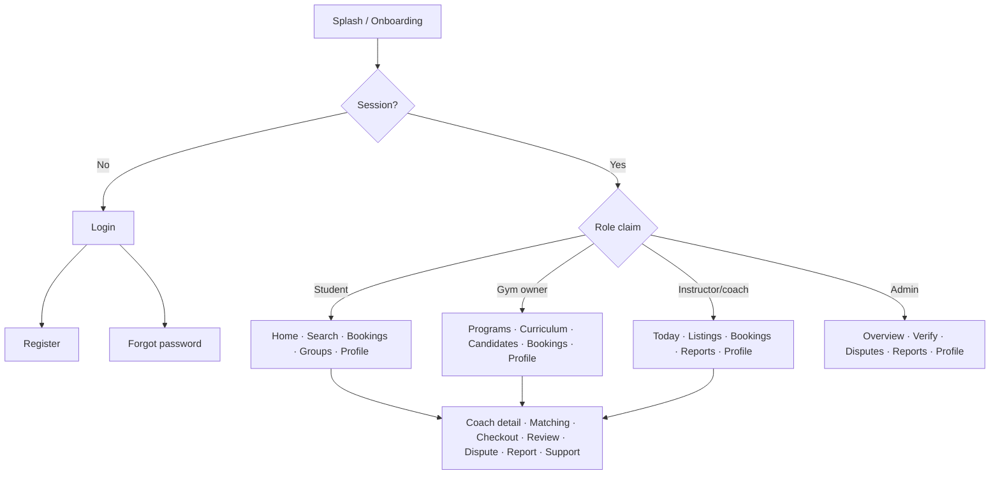
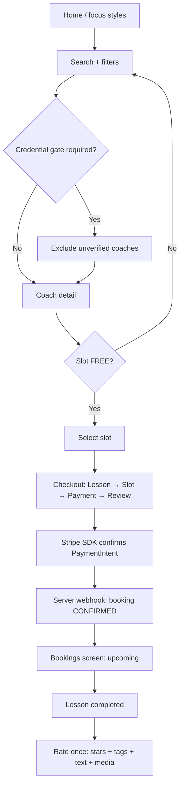
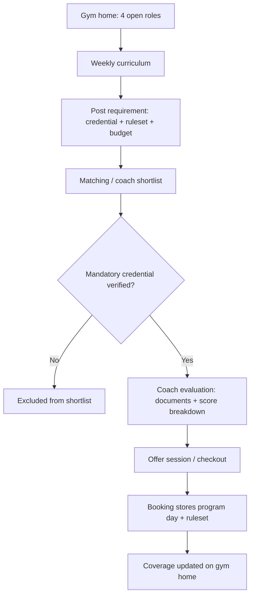
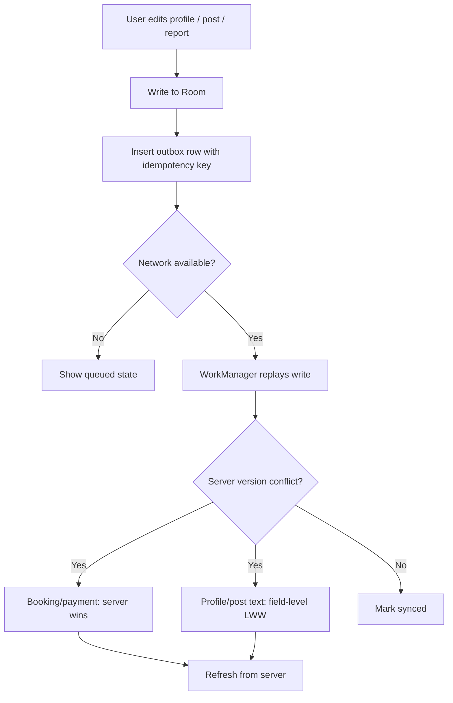
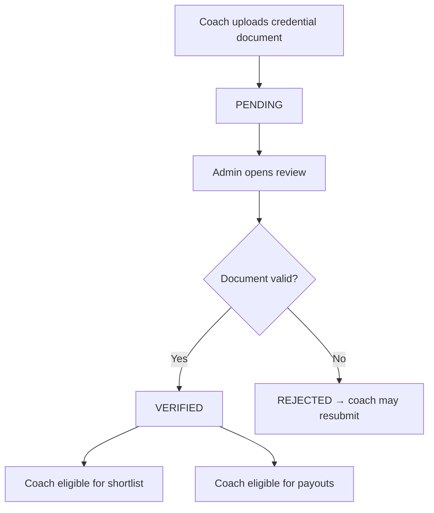

# MoMA — UX/UI Design Specifications

| Field | Value |
|---|---|
| Platform | Android — Jetpack Compose, Material 3 |
| Design baseline | Assignment2.pdf 13 wireframe areas; MoMA_Android_App_Design.md 19 screen specs; MoMA_Android_Solution.html 33-screen inventory and interactive prototype |
| Companion artefact | `MoMA_Interactive_Prototype.html` — standalone clickable prototype (open in a browser) |
| Document version | 1.0 |

---

## 1. Design principles

1. **Trust before transaction.** Verified credentials, transparent pricing, reviews and a visible dispute path appear before the user commits to payment.
2. **Server-authoritative money.** The UI may show `pending`, never `confirmed`, until the server confirms.
3. **Offline-first reads.** Room data renders first with a "Showing saved data" banner; fresh data replaces it silently.
4. **Role-aware by default.** Navigation labels, entry screens and actions adapt to student, coach, gym owner and admin.
5. **Accessible mobile UX.** 48 dp touch targets, TalkBack labels, scalable text, status conveyed by text as well as colour.
6. **Explainable ranking.** Match cards show why a coach was recommended; the credential gate is shown explicitly.

---

## 2. Information architecture

### 2.1 Navigation model

Single `MainActivity` with Navigation Compose `NavHost`.



### 2.2 Role-specific bottom navigation

| Role | Tab labels |
|---|---|
| Student / gym member | Home · Search · Bookings · Groups · Profile |
| Coach / instructor | Today · Listings · Bookings · Reports · Profile |
| Gym owner / program manager | Programs · Curriculum · Candidates · Bookings · Profile |
| Admin / moderator | Overview · Verify · Disputes · Reports · Profile |

---

## 3. Screen inventory and wireframe coverage

The 33 designed screens are grouped below. "Area" refers to one of the 13 brief wireframe areas.

| Flow | Screens | Brief areas |
|---|---|---|
| Onboarding & auth | Splash/Onboarding, Login, Register, Forgot password | 1 |
| Student discovery | Home (focus styles), Search with autocomplete, Coach detail, Matching | 3, 4, 6 |
| Student transaction | Checkout (4 steps), Bookings, Rating & review composer | 7, 9 |
| Student insights | Training dashboard, Profile | 2, 10 |
| Gym (first stakeholder) | Gym home, Weekly curriculum, Coach shortlist, Coach evaluation, Post requirement | 3, 6 |
| Instructor | Instructor home, Listing editor, Availability, Sales report, Payouts | 3, 7, 11 |
| Community & trust | Groups, Group feed, Post composer, Support, Report content, Dispute | 5, 8, 12 |
| Admin | Admin console, Credential verification, Dispute queue, Content moderation | 8, 11 |

---

## 4. Wireframes

Wireframes are low-fidelity, 360 dp-wide Android layouts. All are implemented as clickable screens in the companion HTML prototype.

### 4.1 Register / Login (Area 1)

```
┌──────────────────────────────┐
│ ‹  Join MoMA        Step 1/1 │
│                              │
│  Create your account         │
│  Start training or teaching. │
│  ┌ Full name ──────────────┐ │
│  │ Your name               │ │
│  └──────────────────────────┘ │
│  ┌ Phone ──────────────────┐ │
│  │ 012-345 6789            │ │
│  └──────────────────────────┘ │
│  ┌ Email ──────────────────┐ │
│  │ name@example.com        │ │
│  └──────────────────────────┘ │
│  ┌ Password ───────────────┐ │
│  │ At least 8 characters   │ │
│  └──────────────────────────┘ │
│  I want to                    │
│  [ Learn as student ][ Teach ]│
│  ┌───── Continue ──────────┐ │
│  └──────────────────────────┘ │
│  [ Google ]    [ Facebook ]   │
│  Have an account? Sign in     │
└──────────────────────────────┘
```

**Behaviour:** validate all fields → Supabase Auth signup → create profile row → store JWT securely → route by role. Privacy notice accepted before submit. Password field has visibility toggle on Login. Forgot password always shows a neutral confirmation.

### 4.2 Home / focus styles (Areas 3, 6)

```
┌──────────────────────────────┐
│ MoMA  [BJJ gym]        JB,MY │
│ Build your weekly team       │
│ Focus styles for the program │
│ ┌ 🔍 Search Judo, Wrestling┐ │
│ └────────────────────────────┘
│ Focus styles                 │
│ ┌ BJJ Gi ┐┌BJJ NoGi┐┌ Judo ┐ │
│ └ ───────┘└ ───────┘└ ─────┘ │
│ ┌ Wrestle┐┌Kyokush.┐┌MuayTh┐ │
│ └ ───────┘└ ───────┘└ ─────┘ │
│ Needed for your program      │
│ ┌ Kenji Watanabe   [Verified]│
│ │ Judo 4th dan · RM150/hr    │
│ │ Wed · Judo for BJJ  ★5.0   │
│ └────────────────────────────┘
│ ┌ Mei Ling Tan     [Verified]│
│ │ Muay Thai · RM130/hr ★4.8  │
│ └────────────────────────────┘
│ Home  Search  Bookings Groups│
│            Profile           │
└──────────────────────────────┘
```

### 4.3 Search & discovery (Area 4)

```
┌──────────────────────────────┐
│ ‹  Search             Filters│
│ ┌ 🔍 Judo black belt or ADCC┐ │
│ └────────────────────────────┘
│ suggestions: Judo for BJJ ·  │
│ ADCC · Kyokushin · Muay Thai │
│ [All styles][Black belt✓]    │
│ [ADCC][ACBJJ][Wed/Thu/Fri]   │
│ Results · verified only      │
│ ┌ Kenji Watanabe  [Verified] │
│ │ Judo 4th dan · Wed 19:00   │
│ │ RM150/hr          ★5.0     │
│ └────────────────────────────┘
│ ┌ Rafiq Uddin     [Verified] │
│ │ Wrestler · ADCC · Thu 19:00│
│ └────────────────────────────┘
│ [ Not sure? Use Match Me ]   │
└──────────────────────────────┘
```

**Behaviour:** debounced query (≥2 chars) → autocomplete → filters → cached results with "saved data" banner offline. Verified credential is a hard filter for gym requirements.

### 4.4 Coach detail and slot picker (Areas 3, 7)

```
┌──────────────────────────────┐
│ JUDO FOR BJJ · WED 19:00     │
│ ‹  Kenji Watanabe   Verified │
│ (KW) Judo 4th dan · 12 yrs   │
│ [Black belt verified] ★5.0(64)│
│ Throws, ukemi, grip fighting │
│ adapted for BJJ players.     │
│ [Judo for BJJ][Gi+No-Gi]     │
│ Available this week          │
│ [Wed19][Wed20][Wed21:held]   │
│ [Sat10: booked]              │
│ Credential check             │
│ Dan certificate .... Verified│
│ Coaching licence ... Verified│
│ Ruleset ............ Gi/NoGi │
│ ┌─ Book Judo for BJJ RM150 ┐ │
│ └────────────────────────────┘
└──────────────────────────────┘
```

**Slot states:** `FREE` green outline, `HELD` amber, `BOOKED` grey/disabled, selected solid green. Booking is disabled if the credential gate fails.

### 4.5 Checkout 4-step (Area 7)

```
┌──────────────────────────────┐
│ ‹  Checkout            Secure│
│ Lesson ─ Slot ─ Payment ─Review│
│ Program   Judo for BJJ ·60min │
│ Coach     Kenji Watanabe      │
│ Ruleset   Gi / No-Gi          │
│ When      Wed 19:00           │
│ Where     Gym · Johor Bahru   │
│ Payment method               │
│ (V) Visa ending 4242       › │
│ Lesson price        RM150.00 │
│ Service fee (15%)   Included │
│ ──────────────────────────── │
│ Total today         RM150.00 │
│ ┌ Pay RM150.00 securely ───┐ │
│ └────────────────────────────┘
│ Card details handled by Stripe│
└──────────────────────────────┘
```

**Behaviour:** server creates pending booking + 10-minute hold + PaymentIntent. Client confirms with Stripe SDK. UI stays `PENDING` until the webhook confirms.

### 4.6 Bookings (Area 7)

```
┌──────────────────────────────┐
│ ‹  My bookings                │
│ [Upcoming][Completed][Cancelled]│
│ ┌ Judo for BJJ    CONFIRMED ┐ │
│ │ Kenji · Wed19 · Gi/No-Gi  │ │
│ │ RM150 paid   [View details]│
│ └────────────────────────────┘
│ ┌ Striking for NoGi  PENDING┐ │
│ │ Mei Ling · Fri20 · ACBJJ  │ │
│ │ [Complete payment]        │
│ └────────────────────────────┘
└──────────────────────────────┘
```

### 4.7 Rating & review (Area 9)

```
┌──────────────────────────────┐
│ ‹  Rate your session          │
│ How was your session?        │
│ Rafiq Uddin · Wrestling ·ADCC│
│        ☆ ☆ ☆ ☆ ☆             │
│       Tap a star to rate     │
│ What stood out?              │
│ [Helpful][Easy to learn]     │
│ [Punctual][Good value]       │
│ ┌ Your review ─────────────┐ │
│ │ Share what you learned... │ │
│ └────────────────────────────┘
│ (+) Add photo or video        │
│ ┌───── Submit review ──────┐ │
│ └────────────────────────────┘
```

### 4.8 Dashboard analytics (Area 10)

```
┌──────────────────────────────┐
│ ‹  My progress        Widgets│
│ [Today][Week][Month]         │
│ ┌ 1 ┐ ┌ 60m ┐ ┌ Medium ┐     │
│ │ses│ │ time│ │ intens.│     │
│ └ ──┘ └ ────┘ └ ───────┘     │
│ Last 7 days                  │
│ ▂▄▃▆▄▇▅  M T W T F S S       │
│ Widgets                      │
│ Sessions & duration    [ ● ] │
│ Calories estimate      [ ● ] │
│ Goal streak            [ ○ ] │
└──────────────────────────────┘
```

### 4.9 Gym home & curriculum (first stakeholder) **[Design]**

```
┌──────────────────────────────┐
│ MoMA Gym              Owner  │
│ Build your team              │
│ 4 open roles · 11 candidates │
│ ┌4┐┌11┐┌7┐┌2┐                │
│ │open││verif││days││internal│ │
│ Open requirements            │
│ Wed · Judo black belt HIRING │
│ Thu · Wrestler        HIRING │
│ Fri · Kyokushin+MuayTh HIRING│
│ Manage                       │
│ Weekly curriculum          › │
│ Coach shortlist            › │
│ Post a requirement         › │
└──────────────────────────────┘
```

Weekly curriculum rows: Mon BJJ Gi (internal), Tue BJJ No-Gi (internal), Wed Judo for BJJ (hiring black belt), Thu Wrestling for No-Gi BJJ — ADCC (hiring wrestler), Fri Striking for No-Gi BJJ — ACBJJ Battle Jiu-Jitsu (hiring Kyokushin + Muay Thai), Sat/Sun open mat.

### 4.10 Admin console and verification queue **[Design]**

```
┌──────────────────────────────┐
│ MoMA operations         Admin│
│ Marketplace health           │
│ 1,284 users · 186 verified   │
│ 7 disputes · 12 reports      │
│ Work queues                  │
│ Instructor verification    7 │
│ Disputes                   7 │
│ Content moderation        12 │
│ Sales report               › │
└──────────────────────────────┘
```

Verification queue cards show applicant, credential type (dan grade / competition record / coaching licence), document status, and **Verify / Reject** actions. Approval sets the flag consumed by the mandatory matching gate.

---

## 5. User flow diagrams

### 5.1 Student: search → book → pay → review



### 5.2 Gym: fill a specialist role



### 5.3 Booking and payment sequence (server-authoritative)

```mermaid
sequenceDiagram
    autonumber
    participant App as Android app
    participant Fn as Edge Function
    participant DB as PostgreSQL
    participant Stripe as Stripe
    participant FCM as Firebase Cloud Messaging
    App->>Fn: POST /functions/v1/create-booking
    Fn->>DB: Check slot; HELD for 10 min (transaction)
    Fn->>Stripe: Create PaymentIntent with commission
    Stripe-->>Fn: clientSecret
    Fn-->>App: PENDING_PAYMENT booking + clientSecret
    App->>Stripe: Confirm payment (SDK)
    Stripe->>Fn: Webhook payment_intent.succeeded
    Fn->>DB: booking CONFIRMED, slot BOOKED, payout scheduled
    Fn->>FCM: Send confirmation
    FCM-->>App: Push notification
    App->>DB: Sync into Room
```

### 5.4 Offline write and conflict handling



### 5.5 Admin verification gate



---

## 6. Interaction and component specifications

| Component | States | Rules |
|---|---|---|
| Bottom navigation | active / inactive | 5 items; role-specific labels; 48 dp min; active uses green tint |
| Search field | idle / typing / suggestion-open | Debounce 300 ms **[Proposed]**; suggestions ≥ 2 chars; clear button |
| Filter chip | unselected / selected | Horizontal scroll; selected uses green accent; filters combine with AND |
| Instructor card | default / pressed | Avatar, name, credential badge, rating, style, price; tap opens detail |
| Slot chip | FREE / HELD / BOOKED / selected | Only FREE tappable; HELD amber; BOOKED disabled; selection triggers checkout |
| Status chip | CONFIRMED / PENDING / COMPLETED / CANCELLED / DISPUTED | Text + colour; TalkBack announces status |
| Step progress | completed / current / future | 4 steps; completed and current green; future grey |
| Star rating | 1–5 unselected/selected | Tap sets rating; TalkBack announces "n of 5 stars" |
| Toggle switch | on / off | Widget and listing visibility; immediate local state, queued sync |
| Outbox/banner | saved data / queued / synced | Non-blocking banner; never shown for payment confirmation |
| Empty state | no results / no bookings | Explain why and offer a next action (clear filters, browse styles) |
| Error state | validation / network / conflict | Inline field errors; snackbar for network; conflict refreshes server state |

---

## 7. Design style guide

### 7.1 Colour tokens

| Token | Hex | Usage |
|---|---|---|
| Primary | `#147A58` | Buttons, active nav, selected chips, progress |
| Primary dark | `#0D5C42` | Headers, emphasis text, dark buttons |
| Accent surface | `#E8F6EE` | Selected chip background, verified badge, callouts |
| Background | `#F4F8F6` | App/window background |
| Surface | `#FFFFFF` | Cards, fields, bottom navigation |
| Ink | `#13251E` | Primary text |
| Muted | `#61756C` | Secondary text, labels |
| Line | `#DCE8E1` | Dividers, borders |
| Amber | `#B56A0B` / `#FDF1DD` | HELD / pending / hiring states |
| Red | `#B34242` / `#FBEABA` | Disputes, errors, critical states |
| Blue | `#2A6BB5` / `#E7F0FB` | Informational chips, under review |

Colour is never the only signal: every state chip includes a text label.

### 7.2 Typography

| Role | Size / weight | Notes |
|---|---|---|
| Display / screen title | 20–23 sp, bold (750) | Max two lines |
| Section heading | 15–16 sp, bold (700) | e.g. "Available this week" |
| Body | 12–13 sp, regular | Dense mobile copy |
| Label / caption | 10–11 sp, semi-bold | Form labels, metadata |
| Chip / badge | 9–11 sp, bold | Uppercase for status |
| Button | 12 sp, bold | Full-width primary action |

Font family: Segoe UI / Roboto / system sans-serif. Support system text scaling up to 200% without truncation of critical actions.

### 7.3 Spacing, radius and elevation

| Token | Value |
|---|---|
| Screen horizontal padding | 16 dp |
| Card padding | 11–16 dp |
| Section gap | 18 dp |
| Component gap | 8–12 dp |
| Corner radius | 12–16 dp (cards), 999 dp (chips) |
| Touch target | ≥ 48 dp |
| Elevation | Subtle only: `0 10px 30px rgba(19,60,43,.09)` equivalent |

### 7.4 Iconography and motion

- Simple line icons in bottom navigation: home, search, calendar, group, person.
- No decorative animation on transactional screens; progress and success use short cross-fades (≤ 200 ms) **[Proposed]**.
- Loading uses a small progress indicator; never block the whole app for cached data.

### 7.5 Accessibility rules

- TalkBack labels on all icon-only controls, star rating, chips and toggles.
- Focus order follows visual order; Compose traversal verified per screen.
- Minimum contrast 4.5:1 for body text; primary on white meets this target **[Proposed: verify with scanner]**.
- Status communicated as text ("Pending payment"), not colour alone.

---

## 8. Responsive behaviour

| Width | Layout |
|---|---|
| Phone (360–411 dp) | Single column, 5-item bottom navigation |
| Tablet / foldable (≥ 600 dp) | Two-pane lists for admin and gym queues; bottom navigation retained **[Proposed]** |
| Landscape | Scrolling content; no horizontal truncation of checkout summary |

---

## 9. Interactive prototype

The companion file **`MoMA_Interactive_Prototype.html`** is a self-contained HTML prototype:

- Five role journeys: BJJ gym, student, coach, community/trust, admin.
- Clickable screen rail, bottom navigation, tabs, filter chips, slot selection and star rating.
- Phone frame with status bar and bottom navigation that changes by role.
- Spec panel showing the purpose, elements and behaviour of the current screen.

Open the file in any modern browser. It is a design artefact: buttons simulate navigation and state; no real payments or API calls are made.

> **Visual refresh:** `MoMA_High_Fidelity_UI.html` is the high-fidelity replacement for this low-fidelity wireframe prototype. It keeps the same 33-screen inventory, role-scoped navigation, component states and trust rules, while applying the polished visual system described in §7.

---

## 10. Design acceptance checklist

- [ ] All 13 brief wireframe areas have at least one designed screen.
- [ ] Four role journeys are reachable and role-scoped.
- [ ] Every slot shows FREE / HELD / BOOKED with the ruleset where relevant.
- [ ] Credential gate is visible before booking/shortlisting.
- [ ] Checkout discloses price, service fee and Stripe handling.
- [ ] Bookings show status chips and contextual actions.
- [ ] Offline/saved-data banner is specified for cached reads.
- [ ] 48 dp targets, TalkBack labels and text scaling verified.
- [ ] Prototype screens match wireframes and component states in this document.
