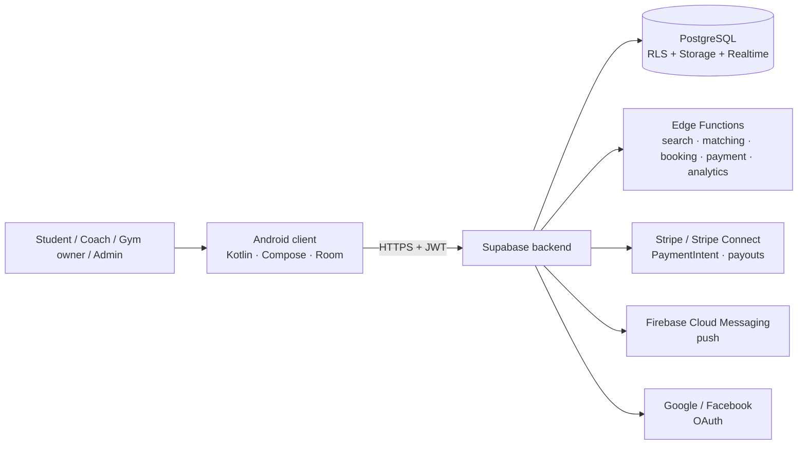
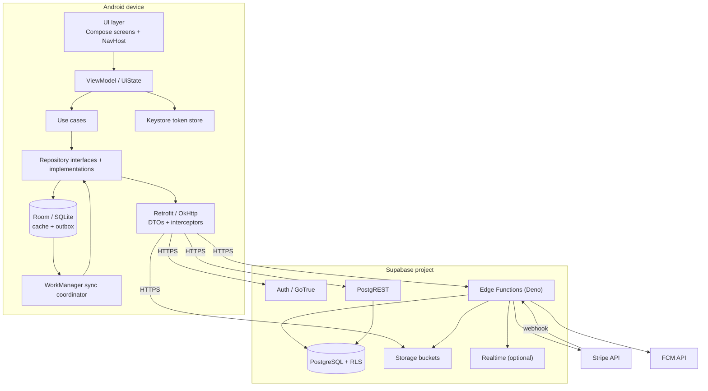
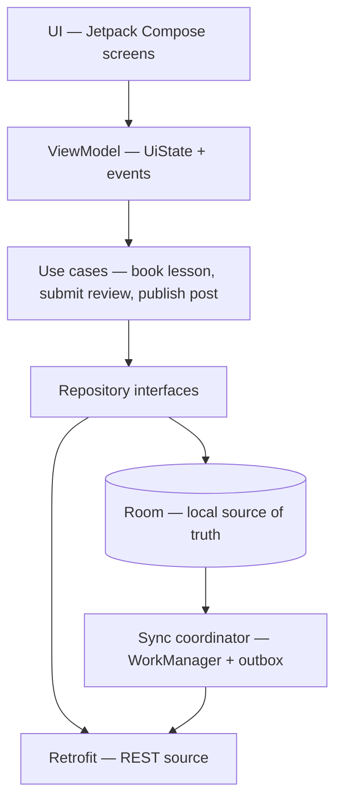
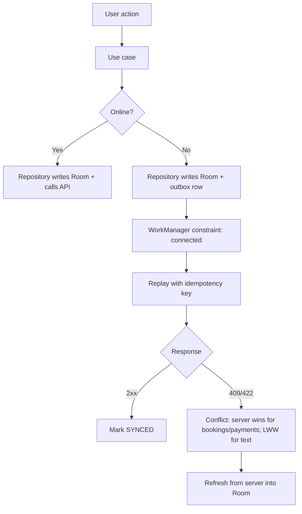
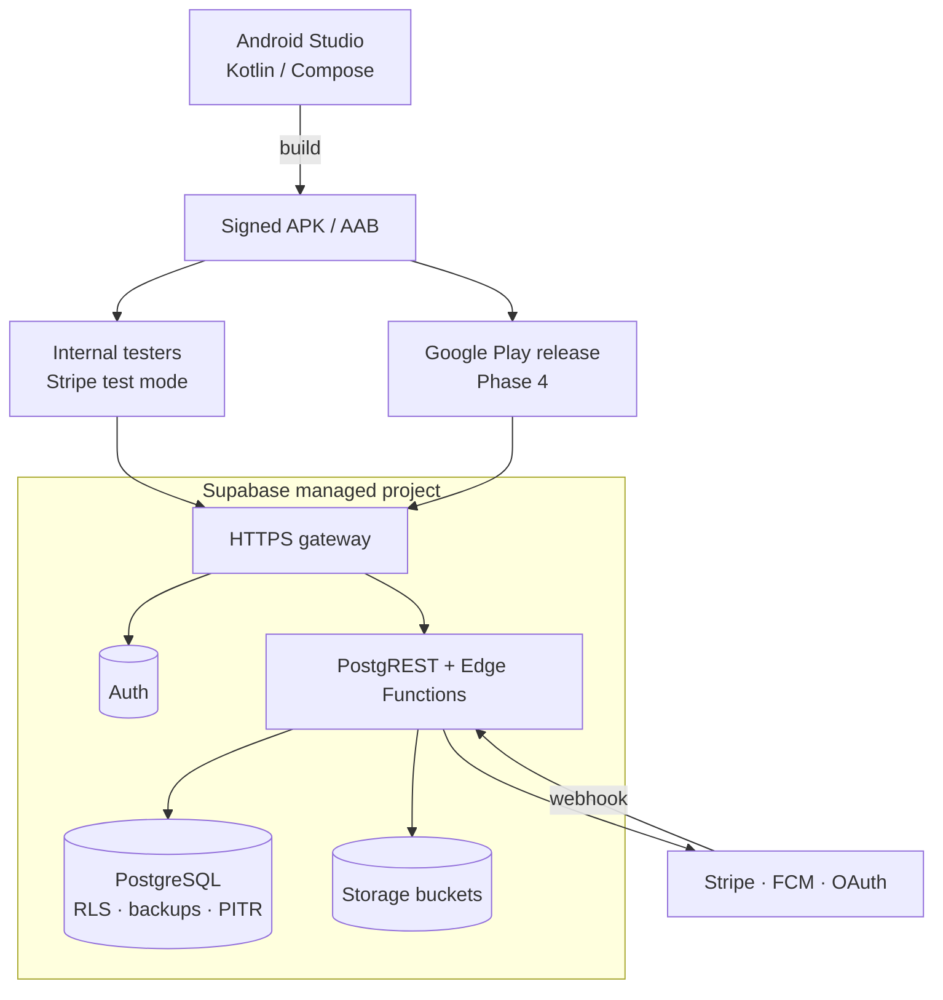
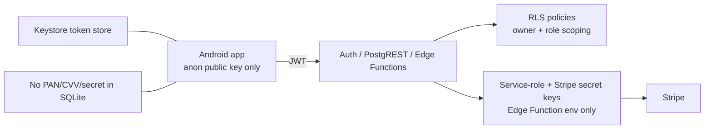

# MoMA — Software Architecture Document (SAD)

| Field | Value |
|---|---|
| System | MoMA Android app + Supabase backend + third-party services |
| Document version | 1.0 |
| Status | Proposed architecture for implementation |
| Drivers | Android-only requirement; gig-marketplace domain; server-authoritative money; offline-first reads; assignment-scale operations |
| Related documents | PRD, SRS, UX/UI Design Specs, DDD, API Documentation |

---

## 1. Architecture overview

### 1.1 Goals and constraints

| Goal / constraint | Architectural response |
|---|---|
| Native Android deliverable | Kotlin + Jetpack Compose, single `MainActivity`, Navigation Compose |
| Relational marketplace (instructors → listings → slots → bookings → reviews → payouts) | PostgreSQL via Supabase with PostgREST and RLS |
| Trusted money and commission logic | Edge Functions own booking holds, PaymentIntents, webhook confirmation, payouts; client never writes money state |
| Intermittent mobile connectivity | Room as local source of truth; outbox + WorkManager for queued writes |
| Fast, testable feature delivery | MVVM + Clean Architecture, Hilt DI, Gradle feature modules |
| Assignment-scale team and operations | Managed backend (Supabase/Firebase/Stripe); no self-hosted cluster |
| Accessibility and quality | Material 3 tokens, 48 dp targets, TalkBack, automated test layers |

### 1.2 System context



### 1.3 Container diagram



---

## 2. Client architecture

### 2.1 Layering rules



**Mandatory rules** **[Design]**

1. UI never talks directly to Room or Retrofit.
2. Remote data is written into Room before screens observe it.
3. Writes are queued in an `outbox` table when offline and replayed with idempotency keys.
4. Bookings and payments are server-authoritative; local state is `pending` until confirmed.
5. Domain models are separate from Room entities and API DTOs.

### 2.2 Gradle module structure

| Module | Responsibility |
|---|---|
| `:app` | `MainActivity`, theme, navigation graph, Hilt application class |
| `:core:model` | Domain models: `User`, `Instructor`, `Lesson`, `Booking`, `Review`, `Post`, `GymProgram`, `CoachRequirement`, `Credential` |
| `:core:common` | `Result`, dispatchers, constants, error mapping |
| `:core:database` | Room entities, DAOs, migrations, outbox, type converters |
| `:core:network` | Retrofit services, DTOs, auth/interceptors, MockWebServer contracts |
| `:core:datastore` | Settings, session, secure token store |
| `:feature:auth` | Register, login, forgot password |
| `:feature:discovery` | Home, categories, search, matching, coach detail |
| `:feature:booking` | Availability, checkout, payment result, bookings |
| `:feature:review` | Rating and review composer |
| `:feature:forum` | Groups, feed, comments, composer |
| `:feature:dashboard` | Training analytics, widgets, sales report |
| `:feature:support` | Support, reports, disputes |
| `:feature:admin` | Verification, moderation, payouts (phone/tablet) |

### 2.3 Navigation structure

- Unauthenticated graph: Splash → Onboarding → Login → Register → Forgot password.
- Authenticated graph: role-specific bottom bar (see UX specs §2).
- Modal/full-screen flows: coach detail, matching, checkout, payment result, review, dispute, report, support, admin console.
- Role-aware destinations are gated by the JWT role claim and RLS.

### 2.4 Offline sync architecture



Outbox fields: `entity`, `entity_id`, `operation`, `payload_json`, `idempotency_key`, `retry_count`, `created_at`. Failed replays use exponential backoff; booking/payment are never queued offline.

---

## 3. Backend architecture

### 3.1 Supabase services

| Service | Role in MoMA |
|---|---|
| PostgreSQL | Relational source of truth for users, listings, slots, bookings, reviews, forum, gym program, reports |
| Row Level Security | Per-user and per-role data isolation; primary client-facing security boundary |
| Auth (GoTrue) | Email/password, Google/Facebook, password recovery, JWT sessions |
| PostgREST | Auto-generated REST endpoints with query filters |
| Storage | Avatars, listing images, review media, dispute evidence |
| Edge Functions (Deno) | Trusted logic: search, matching, booking creation/confirmation/cancellation, commission, payouts, notifications, analytics aggregation |
| Realtime (optional) | Live forum thread updates in Phase 2 |

### 3.2 Why Supabase was selected

| Option | Strength | Why not primary |
|---|---|---|
| Firebase Auth + Firestore + Functions | Excellent mobile SDKs, realtime | Denormalised model complicates bookings, availability and relational reports |
| Custom Ktor/NestJS + PostgreSQL | Full control | Highest implementation and operational effort for this assignment |
| **Supabase** | Relational + auth + storage + serverless logic | **Selected** |

### 3.3 Trusted business logic in Edge Functions

| Function | Responsibility | Critical rule |
|---|---|---|
| `search` | Autocomplete and filtered search | Returns only allowed listings; verified-credential hard filter for gym queries |
| `match-instructors` | Credential gate + weighted ranking | Gate before score; returns factor breakdown |
| `create-booking` | Atomic slot hold + PaymentIntent | Transactional slot check; 10-minute hold; commission from server config |
| `confirm-booking` | Webhook-driven confirmation | Verifies Stripe event; sets booking/slot/payout state |
| `cancel-booking` | Refund and cancellation policy | Client cannot set status directly |
| `notify` | FCM dispatch | Deep links into the app |
| `analytics/dashboard` | Today/Week/Month aggregates | Scoped to requesting user |
| `reports/sales` | Instructor/admin aggregates | Role-protected; no raw payment data |

### 3.4 Booking / payment sequence

```mermaid
sequenceDiagram
    autonumber
    participant App as Android app
    participant Fn as Edge Function
    participant DB as PostgreSQL
    participant Stripe as Stripe
    participant FCM as Firebase Cloud Messaging
    App->>Fn: POST /functions/v1/create-booking
    Fn->>DB: Check slot; HELD for 10 minutes (transaction)
    Fn->>Stripe: Create PaymentIntent with application_fee_amount
    Stripe-->>Fn: clientSecret
    Fn-->>App: PENDING_PAYMENT booking + clientSecret
    App->>Stripe: Confirm payment (SDK)
    Stripe->>Fn: Webhook payment_intent.succeeded
    Fn->>DB: booking CONFIRMED, slot BOOKED, payout scheduled
    Fn->>FCM: Send confirmation
    FCM-->>App: Push notification
    App->>DB: Sync into Room
```

---

## 4. Technology stack

| Concern | Choice | Reason / note |
|---|---|---|
| IDE / language | Android Studio + Kotlin | Native requirement; concise, coroutine-friendly |
| UI | Jetpack Compose + Material 3 | Fast iteration on card/list/dashboard wireframes; green accent theme |
| Navigation | Navigation Compose | Single activity, typed routes, deep links |
| Architecture | MVVM + Clean Architecture | Separation of UI, domain and data |
| Local DB | Room over SQLite | Type-safe SQLite, migrations, `Flow`; satisfies SQLite requirement |
| Async | Coroutines + Flow | Lifecycle-aware streams |
| DI | Hilt | Testable repositories/ViewModels |
| HTTP | Retrofit + OkHttp + kotlinx.serialization | Clean REST client for Supabase/Edge Functions |
| Background work | WorkManager | Reliable offline write sync |
| Secure storage | EncryptedSharedPreferences / Android Keystore | JWT and refresh token protection |
| Images | Coil | Avatar, listing, review media |
| Maps / location | Google Maps SDK (optional) | Coarse location for nearby search; request just-in-time |
| Payments | Stripe Android SDK | Client tokenisation; card data never touches MoMA SQLite |
| Push | Firebase Cloud Messaging | Booking, payment, dispute, forum notifications |
| Observability | Firebase Crashlytics + Analytics (optional) | Crash and usage monitoring |
| Backend | Supabase (PostgreSQL, Auth, PostgREST, Storage, Edge Functions) | See §3.2 |
| SDK baseline | minSdk 26; latest stable compile/target; Kotlin 2.x; Compose BOM via version catalog | Design baseline |

---

## 5. Third-party integrations

| Provider | Integration point | Data exchanged | Failure handling |
|---|---|---|---|
| Supabase Auth | App → `/auth/v1` | Email/password, OAuth tokens, JWT | Retry with backoff; clear session on 401; neutral reset message |
| Supabase REST | App → `/rest/v1` | CRUD for user-owned tables | Room fallback; outbox for writes |
| Supabase Storage | App → `/storage/v1` | Avatar/listing/review/evidence media | Queued upload; allowlisted MIME and size |
| Stripe Android SDK | App → Stripe | Payment method tokenisation, PaymentIntent confirmation | Show pending state; retry confirmation; never log card data |
| Stripe webhooks | Stripe → Edge Function | `payment_intent.succeeded`, payout events | Idempotent event handling; verify signature |
| Stripe Connect | Edge Function → Stripe | Transfers to coach accounts | Payout status mirrored in `payouts` |
| FCM | Edge Function → FCM → device | Push payload with deep link | Notification stored in local inbox; deep link on tap |
| Google / Facebook OAuth | Supabase Auth → provider | Social sign-in | Fall back to email/password |
| Google Maps SDK (optional) | App → Google | Coarse location / nearby search | Degrade to city filter |

---

## 6. Infrastructure and deployment view



**Environments** **[Proposed]**

| Environment | Purpose | Data |
|---|---|---|
| Local / test | Android emulator + Supabase test project | Stripe test keys; synthetic users |
| Staging | Internal testers, Maestro E2E, accessibility checks | Anonymised seed data |
| Production | Play Store release | Real data; certificate pinning; secret keys only in Edge Functions |

**Operational posture:** managed services; no self-managed servers. Backups and PITR delegated to Supabase. Availability target ≥ 99.5% monthly (see SRS NFR-AVA-01).

---

## 7. Security architecture



- RLS is the security boundary; the anon/public key is safe in the app **[Design]**.
- HTTPS only; certificate pinning for production builds.
- Keystore-backed access/refresh tokens; cleared on logout.
- Admin-only writes for verification, dispute, moderation and payout state.
- Upload allowlists: image ≤ 10 MB, video ≤ 100 MB, server re-scan.
- PDPA-aligned notice at registration; deletion request flow.

---

## 8. Key architectural decisions

| ID | Decision | Alternatives considered | Rationale |
|---|---|---|---|
| ADR-01 | Supabase backend | Firebase stack; custom Ktor/NestJS | Relational model + RLS + serverless trusted logic with low ops effort |
| ADR-02 | Room as local source of truth | Direct Retrofit calls in ViewModels | Offline reads, `Flow` observables, clear conflict handling |
| ADR-03 | Edge Functions for booking/payment | Client-side state transitions | Prevents forged confirmations; commission stays server-side |
| ADR-04 | Outbox + WorkManager | Immediate network writes only | Reliable offline writes with idempotency |
| ADR-05 | Feature modules | Single monolithic module | Clear ownership, faster builds, testability |
| ADR-06 | Credential gate before scoring | Score then filter | Gym requirement is mandatory; avoids misleading ranked lists |
| ADR-07 | Material 3 + custom green tokens | Custom design system | Matches wireframes, accessibility built in |

---

## 9. Quality and verification architecture

| Level | Scope | Tooling |
|---|---|---|
| Unit | ViewModels, use cases, commission/score formatting | JUnit, Turbine |
| Room | DAOs, migrations, foreign keys, outbox replay | Robolectric / instrumented tests |
| Network | Retrofit contracts, error mapping | MockWebServer |
| Compose UI | Navigation, validation, snapshots | Compose test rules |
| Integration | Mock Supabase + Stripe test mode | Staging project |
| E2E | register → search → book → pay → review; join → post → comment | Maestro |
| Non-functional | Accessibility Scanner, TalkBack, low network, leaks | Android tooling |

---

## 10. Architecture acceptance checks

- [ ] UI has no direct Room/Retrofit dependency.
- [ ] All remote reads land in Room before observation.
- [ ] Offline writes use outbox + idempotency keys.
- [ ] Booking/payment/payout/verification state cannot be changed from the client.
- [ ] No secret or PAN/CVV exists in client code, SQLite or logs.
- [ ] RLS policies cover every client-accessible table.
- [ ] Credential gate runs before matching score.
- [ ] Role-specific navigation is enforced by both UI and backend claims.
- [ ] Every Edge Function logs with a `traceId` propagated to API errors.
