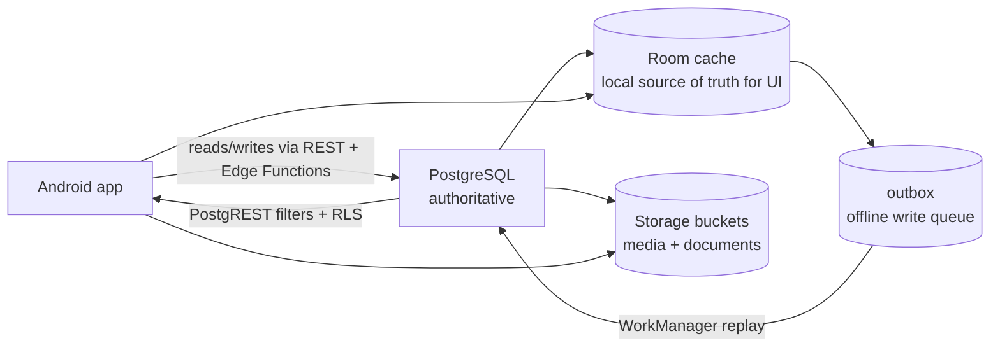

# MoMA — Database Design Document (DDD)

| Field | Value |
|---|---|
| Scope | Server-side PostgreSQL (Supabase) + client-side Room/SQLite |
| Document version | 1.0 |
| Status | Proposed schema for implementation |
| Related documents | SRS, SAD, API Documentation |

> **Authority model.** PostgreSQL is the system of record. Room/SQLite mirrors only the data a screen needs and never decides booking, payment, payout or verification state.

---

## 1. Data architecture



### 1.1 Table groups

| Group | Tables |
|---|---|
| Identity | `users`, `instructor_profiles`, `martial_art_styles`, `credentials` |
| Gym program | `gyms`, `gym_programs`, `program_schedules`, `coach_requirements` |
| Marketplace | `lesson_listings`, `availability_slots`, `bookings`, `payments`, `payouts` |
| Trust | `reviews`, `review_media`, `reports`, `disputes`, `support_tickets` |
| Community | `forum_groups`, `group_members`, `posts`, `comments`, `post_likes` |
| System | `notifications`, `analytics_events`, `dashboard_widgets`, `outbox` |

---

## 2. Entity–Relationship diagram

```mermaid
erDiagram
    USERS ||--o| INSTRUCTOR_PROFILES : has
    USERS ||--o{ BOOKINGS : "books as student"
    USERS ||--o{ REVIEWS : writes
    USERS ||--o{ POSTS : writes
    USERS ||--o{ REPORTS : submits
    USERS ||--o{ SUPPORT_TICKETS : submits
    USERS ||--o{ CREDENTIALS : owns
    GYMS ||--o{ GYM_PROGRAMS : publishes
    GYM_PROGRAMS ||--o{ PROGRAM_SCHEDULES : contains
    GYM_PROGRAMS ||--o{ COACH_REQUIREMENTS : defines
    COACH_REQUIREMENTS ||--o{ BOOKINGS : "filled by"
    INSTRUCTOR_PROFILES ||--o{ LESSON_LISTINGS : publishes
    INSTRUCTOR_PROFILES ||--o{ AVAILABILITY_SLOTS : offers
    MARTIAL_ART_STYLES ||--o{ LESSON_LISTINGS : classifies
    MARTIAL_ART_STYLES ||--o{ GYM_PROGRAMS : classifies
    LESSON_LISTINGS ||--o{ AVAILABILITY_SLOTS : offers
    AVAILABILITY_SLOTS ||--o| BOOKINGS : reserves
    BOOKINGS ||--o| PAYMENTS : "paid by"
    BOOKINGS ||--o| PAYOUTS : "settled by"
    BOOKINGS ||--o| REVIEWS : receives
    BOOKINGS ||--o| DISPUTES : "may have"
    REVIEWS ||--o{ REVIEW_MEDIA : includes
    FORUM_GROUPS ||--o{ GROUP_MEMBERS : has
    FORUM_GROUPS ||--o{ POSTS : contains
    POSTS ||--o{ COMMENTS : has
    POSTS ||--o{ POST_LIKES : receives
    USERS ||--o{ GROUP_MEMBERS : joins

    USERS {
        uuid id PK
        text role
        text full_name
        text email
        text phone
        text city
        timestamptz updated_at
    }
    INSTRUCTOR_PROFILES {
        uuid user_id PK, FK
        text bio
        text styles_csv
        int experience_years
        text qualifications
        int hourly_rate_cents
        numeric rating_avg
        int review_count
        bool verified
    }
    GYMS {
        uuid id PK
        uuid owner_id FK
        text name
        text city
    }
    GYM_PROGRAMS {
        uuid id PK
        uuid gym_id FK
        uuid style_id FK
        text title
        int day_of_week
        text ruleset
    }
    COACH_REQUIREMENTS {
        uuid id PK
        uuid program_id FK
        text required_style
        text minimum_credential
        text ruleset_experience
        int budget_cents
        text status
    }
    CREDENTIALS {
        uuid id PK
        uuid user_id FK
        text type
        text issuing_body
        text rank_or_licence
        text document_url
        text status
        uuid verified_by FK
    }
    LESSON_LISTINGS {
        uuid id PK
        uuid instructor_id FK
        uuid style_id FK
        text title
        text ruleset
        text level
        int duration_min
        int price_cents
        text city
        bool active
    }
    AVAILABILITY_SLOTS {
        uuid id PK
        uuid listing_id FK
        timestamptz starts_at
        timestamptz ends_at
        text status
        int version
    }
    BOOKINGS {
        uuid id PK
        uuid student_id FK
        uuid instructor_id FK
        uuid listing_id FK
        uuid slot_id FK
        uuid requirement_id FK
        text status
        int amount_cents
        int commission_cents
        text ruleset
        text payment_intent_id
        timestamptz starts_at
    }
    PAYMENTS {
        uuid id PK
        uuid booking_id FK
        text provider_payment_id
        int amount_cents
        text status
        timestamptz paid_at
    }
    PAYOUTS {
        uuid id PK
        uuid instructor_id FK
        uuid booking_id FK
        int gross_cents
        int fee_cents
        int net_cents
        text status
    }
    REVIEWS {
        uuid id PK
        uuid booking_id FK, UNIQUE
        uuid instructor_id FK
        uuid student_id FK
        int rating
        text title
        text body
    }
    DISPUTES {
        uuid id PK
        uuid booking_id FK
        uuid raised_by FK
        text reason
        text details
        text evidence_urls_csv
        text status
    }
    FORUM_GROUPS {
        uuid id PK
        text name
        text rules
        int member_count
    }
    POSTS {
        uuid id PK
        uuid group_id FK
        uuid author_id FK
        text body
        int like_count
        int comment_count
    }
```

---

## 3. Server schema (PostgreSQL / Supabase)

### 3.1 Identity

**`users`**

| Column | Type | Constraints / notes |
|---|---|---|
| `id` | uuid | PK; matches Supabase Auth user id |
| `role` | text | `STUDENT` / `INSTRUCTOR` / `ADMIN` (gym owner implemented as instructor with gym ownership) |
| `full_name`, `email`, `phone`, `city` | text | Contact/profile fields; `email` unique |
| `avatar_url` | text | Storage path |
| `privacy_accepted_at` | timestamptz | PDPA notice acceptance |
| `created_at`, `updated_at` | timestamptz | `updated_at` maintained by trigger |

**`instructor_profiles`**

| Column | Type | Constraints / notes |
|---|---|---|
| `user_id` | uuid | PK + FK → `users(id)` |
| `bio`, `styles_csv`, `qualifications` | text | Portfolio content |
| `experience_years` | int | ≥ 0 |
| `hourly_rate_cents` | int | ≥ 0; MYR minor units |
| `rating_avg`, `review_count` | numeric / int | Derived aggregates, maintained by trigger/function |
| `verified` | bool | False until admin approves credentials |

**`martial_art_styles`**

| Column | Type | Notes |
|---|---|---|
| `id` | uuid | PK |
| `name` | text | Release 1: BJJ Gi, BJJ No-Gi, Judo, Wrestling, Kyokushin Karate, Muay Thai |
| `icon_url`, `sort_order` | text / int | Catalogue presentation |

**`credentials`**

| Column | Type | Notes |
|---|---|---|
| `id` | uuid | PK |
| `user_id` | uuid | FK → `users(id)` |
| `type` | text | `DAN_GRADE`, `COMPETITION_RECORD`, `COACHING_LICENCE`, `BLACK_BELT` |
| `issuing_body`, `rank_or_licence` | text | Issuer and rank/licence number |
| `document_url` | text | Storage path; server-re scanned |
| `status` | text | `PENDING` / `UNDER_REVIEW` / `VERIFIED` / `REJECTED` |
| `verified_by` | uuid | FK → `users(id)` (admin), nullable |
| `verified_at` | timestamptz | Nullable |

### 3.2 Gym program

**`gyms`**: `id` uuid PK, `owner_id` uuid FK → users, `name` text, `city` text.

**`gym_programs`**: `id` uuid PK, `gym_id` uuid FK, `style_id` uuid FK, `title` text, `day_of_week` int (0–6), `ruleset` text (`GI`, `NO_GI`, `ADCC`, `ACBJJ_BATTLE_JIU_JITSU`, `OPEN_MAT`).

**`program_schedules`**: `id` uuid PK, `program_id` uuid FK, `starts_at` timestamptz, `ends_at` timestamptz, `coach_user_id` uuid FK nullable, `status` text (`OPEN`, `ASSIGNED`, `COVERED`).

**`coach_requirements`**

| Column | Type | Notes |
|---|---|---|
| `id` | uuid | PK |
| `program_id` | uuid | FK → `gym_programs(id)` |
| `required_style` | text | e.g. `JUDO`, `WRESTLING`, `KYOKUSHIN`, `MUAY_THAI` |
| `minimum_credential` | text | e.g. `Judo black belt (verified)` |
| `ruleset_experience` | text | `GI_NO_GI` / `ADCC` / `ACBJJ_BATTLE_JIU_JITSU` |
| `budget_cents` | int | MYR minor units |
| `status` | text | `OPEN` / `FILLED` / `CLOSED` |

Seed curriculum (gym-first scope) **[Design]**: Mon BJJ Gi (internal), Tue BJJ No-Gi (internal), Wed Judo for BJJ (Judo black belt, Gi/No-Gi), Thu Wrestling for No-Gi BJJ (wrestler, ADCC), Fri Striking for No-Gi BJJ (Kyokushin + Muay Thai, ACBJJ Battle Jiu-Jitsu), Sat/Sun open mat.

### 3.3 Marketplace

**`lesson_listings`**

| Column | Type | Notes |
|---|---|---|
| `id` | uuid | PK |
| `instructor_id` | uuid | FK → `users(id)` |
| `style_id` | uuid | FK → `martial_art_styles(id)` |
| `title`, `description` | text | Listing content |
| `ruleset` | text | Ruleset tag |
| `level` | text | `BEGINNER` / `INTERMEDIATE` / `ADVANCED` |
| `duration_min` | int | 60 or 90 in v1 |
| `price_cents` | int | MYR minor units |
| `city`, `lat`, `lng` | text / numeric | Location |
| `active` | bool | Controls search visibility |

**`availability_slots`**

| Column | Type | Notes |
|---|---|---|
| `id` | uuid | PK |
| `listing_id` | uuid | FK → `lesson_listings(id)` |
| `starts_at`, `ends_at` | timestamptz | UTC |
| `status` | text | `FREE` / `HELD` / `BOOKED` |
| `version` | int | Optimistic concurrency; incremented on state change |
| `hold_expires_at` | timestamptz | 10-minute hold expiry |

**`bookings`**

| Column | Type | Notes |
|---|---|---|
| `id` | uuid | PK |
| `student_id`, `instructor_id` | uuid | FK → `users(id)` |
| `listing_id` | uuid | FK → `lesson_listings(id)` |
| `slot_id` | uuid | FK → `availability_slots(id)` |
| `requirement_id` | uuid | nullable FK → `coach_requirements(id)` |
| `status` | text | `PENDING_PAYMENT` / `CONFIRMED` / `COMPLETED` / `CANCELLED` / `DISPUTED` |
| `amount_cents`, `commission_cents` | int | Server-resolved; commission 10–20% |
| `currency` | text | `MYR` |
| `payment_intent_id` | text | Stripe id |
| `ruleset` | text | Stored on booking for gym program auditing |
| `starts_at` | timestamptz | Lesson time |
| `created_at`, `updated_at` | timestamptz | Audit |

**`payments`** — `id` uuid PK, `booking_id` uuid FK, `provider` text (`STRIPE`), `provider_payment_id` text, `amount_cents` int, `status` text, `paid_at` timestamptz. **No PAN/CVV columns.**

**`payouts`** — `id` uuid PK, `instructor_id` uuid FK, `booking_id` uuid FK, `gross_cents`, `fee_cents`, `net_cents` int, `status` text, `created_at` timestamptz. Client-writable: **no**.

### 3.4 Trust

**`reviews`** — `id` uuid PK, `booking_id` uuid FK **UNIQUE**, `instructor_id` uuid FK, `student_id` uuid FK, `rating` int CHECK 1–5, `title`, `body` text, `created_at` timestamptz.

**`review_media`** — `id` uuid PK, `review_id` uuid FK, `remote_url` text, `media_type` text (`IMAGE`/`VIDEO`), `upload_state` text.

**`reports`** — `id` uuid PK, `reporter_id` uuid FK, `target_type` text, `target_id` uuid, `reason` text (spam, hate speech, false information, adult content, violence, IP violation, other), `details` text, `status` text, `created_at` timestamptz.

**`disputes`** — `id` uuid PK, `booking_id` uuid FK, `raised_by` uuid FK, `reason`, `details` text, `evidence_urls_csv` text, `status` text (`OPEN`/`UNDER_REVIEW`/`RESOLVED`), `resolution` text, `resolved_by` uuid FK nullable.

**`support_tickets`** — `id` uuid PK, `subject`, `issue`, `image_url`, `email`, `phone` text, `status` text, `created_at` timestamptz.

### 3.5 Community

**`forum_groups`** — `id` uuid PK, `name`, `description`, `rules` text, `member_count` int, `created_at`.

**`group_members`** — `group_id` uuid FK, `user_id` uuid FK, `role` text (`MEMBER`/`MODERATOR`), PRIMARY KEY (`group_id`, `user_id`).

**`posts`** — `id` uuid PK, `group_id` uuid FK, `author_id` uuid FK, `body` text, `media_urls_csv` text, `like_count`, `comment_count` int, `created_at`.

**`comments`** — `id` uuid PK, `post_id` uuid FK, `author_id` uuid FK, `body` text, `created_at`.

**`post_likes`** — `post_id` uuid FK, `user_id` uuid FK, PRIMARY KEY (`post_id`, `user_id`).

### 3.6 System

| Table | Columns / notes |
|---|---|
| `notifications` | `id`, `user_id`, `type`, `title`, `body`, `deep_link`, `read`, `created_at` |
| `analytics_events` | `id`, `user_id`, `event_type`, `entity_id`, `value_json`, `occurred_at`, `synced` |
| `dashboard_widgets` | `id`, `user_id`, `widget_type`, `position` int, `enabled` bool |
| `outbox` (client-side primarily) | `id`, `entity`, `entity_id`, `operation`, `payload_json`, `idempotency_key` UNIQUE, `retry_count`, `created_at` |

---

## 4. Client schema (Room / SQLite)

Room mirrors the tables needed by screens; it adds `sync_status`, `local_uri` and `upload_state` fields that do not exist on the server.

| Room entity | Important columns | Notes |
|---|---|---|
| `users` | `id`, `role`, `full_name`, `email`, `phone`, `avatar_url`, `city`, `updated_at`, `sync_status` | **No password stored locally** |
| `instructor_profiles` | `user_id`, `bio`, `styles_csv`, `experience_years`, `qualifications`, `hourly_rate_cents`, `rating_avg`, `review_count`, `verified`, `lat`, `lng` | One-to-one with user |
| `martial_art_styles` | `id`, `name`, `icon_url`, `sort_order` | Cached catalogue |
| `credentials` | `id`, `user_id`, `type`, `issuing_body`, `rank_or_licence`, `document_url`, `status` | Verification state for gate UI |
| `gyms`, `gym_programs`, `program_schedules`, `coach_requirements` | Server columns + `sync_status` | Gym-first screens |
| `lesson_listings` | `id`, `instructor_id`, `style_id`, `title`, `description`, `level`, `ruleset`, `duration_min`, `price_cents`, `city`, `lat`, `lng`, `active` | Instructor offer |
| `availability_slots` | `id`, `listing_id`, `starts_at`, `ends_at`, `status`, `version` | FREE/HELD/BOOKED |
| `bookings` | `id`, `student_id`, `instructor_id`, `listing_id`, `slot_id`, `status`, `amount_cents`, `commission_cents`, `currency`, `payment_intent_id`, `ruleset`, `starts_at`, `sync_status` | Pending until server confirms |
| `payments`, `payouts` | Read-only mirrors | Never client-writable |
| `reviews` | `id`, `booking_id` UNIQUE, `instructor_id`, `student_id`, `rating`, `title`, `body`, `created_at`, `sync_status` | One per booking |
| `review_media` | `id`, `review_id`, `local_uri`, `remote_url`, `media_type`, `upload_state` | Queued uploads |
| `forum_groups`, `group_members`, `posts`, `comments`, `post_likes` | As server + `sync_status` | Optimistic community writes |
| `reports`, `disputes`, `support_tickets` | As server + `sync_status` | Offline drafts |
| `notifications`, `analytics_events`, `dashboard_widgets` | As server | Local inbox / usage queue / layout |
| `outbox` | `id`, `entity`, `entity_id`, `operation`, `payload_json`, `idempotency_key`, `retry_count`, `created_at` | Offline write queue |

### 4.1 Indexes and integrity

- Indexes: `bookings(student_id, starts_at)`, `bookings(instructor_id, status)`, `availability_slots(listing_id, starts_at)`, `posts(group_id, created_at)`, `reviews(instructor_id, rating)`, `coach_requirements(program_id, status)`.
- Enable `PRAGMA foreign_keys = ON`.
- Use `version` / `updated_at` for conflict detection.
- Use versioned Room migrations (`Migration(1, 2)`, …) from the first release; never destructive migration.

### 4.2 Illustrative Room entity and DAO

```kotlin
@Entity(tableName = "bookings")
data class BookingEntity(
    @PrimaryKey val id: String,
    val studentId: String,
    val instructorId: String,
    val listingId: String,
    val slotId: String,
    val status: String,
    val amountCents: Int,
    val commissionCents: Int,
    val currency: String = "MYR",
    val paymentIntentId: String? = null,
    val ruleset: String? = null,
    val startsAt: String,
    val updatedAt: String,
    val syncStatus: String = "SYNCED"
)

@Dao
interface BookingDao {
    @Query("SELECT * FROM bookings WHERE studentId = :studentId ORDER BY startsAt DESC")
    fun observeForStudent(studentId: String): Flow<List<BookingEntity>>

    @Query("SELECT * FROM bookings WHERE syncStatus = 'PENDING'")
    suspend fun pending(): List<BookingEntity>

    @Upsert
    suspend fun upsertAll(bookings: List<BookingEntity>)
}
```

---

## 5. Storage rules

### 5.1 Buckets

| Bucket | Content | Max size | MIME allowlist | Access |
|---|---|---|---|---|
| `avatars` | Profile images | 10 MB | `image/jpeg`, `image/png`, `image/webp` | Owner read/write; public read |
| `listing-media` | Listing images | 10 MB | image types | Owner write; public read |
| `review-media` | Review photos/videos | image 10 MB / video 100 MB | `image/*`, `video/mp4` | Review author write; public read |
| `credential-documents` | Dan certificates, licences, competition records | 10 MB | `application/pdf`, image types | Owner write; admin read; **never public** |
| `dispute-evidence` | Screenshots/photos | 10 MB | image types | Raised-by user + admins |
| `support-attachments` | Support images | 10 MB | image types | Submitter + admins |

All uploads are re-scanned server-side; object paths are namespaced by user id.

### 5.2 Row Level Security (RLS) policies

| Table | Select | Insert / update / delete |
|---|---|---|
| `users` | Own row; public profile fields for discovery | Own row only |
| `instructor_profiles` | Public | Owner (instructor) only |
| `credentials` | Owner + admins | Owner inserts; **only admins update status** |
| `lesson_listings` | Public where `active = true`; owner sees all own | Owner only |
| `availability_slots` | Public for active listings | Owner only; status changes via Edge Function service role |
| `bookings` | Student = `auth.uid()`; instructor = `instructor_id`; admin all | Created via Edge Function; no direct client status writes |
| `payments`, `payouts` | Involved user / admin | Service role only |
| `reviews` | Public | Student with `booking_id` where booking is COMPLETED and same student; one per booking |
| `forum_groups` | Public | Admin/moderator |
| `group_members` | Members | Self join/leave; admin for role changes |
| `posts`, `comments`, `post_likes` | Group members only | Author/member; moderation by admin |
| `reports`, `disputes`, `support_tickets` | Reporter/raised-by + admins | Submitter insert; admin status updates |
| `notifications`, `dashboard_widgets`, `analytics_events` | Own rows | Own rows; Edge Functions for system events |

### 5.3 Retention and lifecycle

| Data class | Rule **[Proposed — confirm with operations]** |
|---|---|
| Booking/payment records | Retain 7 years for financial audit |
| Disputes and support tickets | 24 months after closure |
| Reports | 24 months after resolution |
| Analytics events | 24 months, then aggregate and purge |
| Notification inbox | 90 days |
| Outbox rows | Delete on successful replay; alert after repeated failure |
| Account deletion | Anonymise user profile; remove media; retain legally required financial records |

---

## 6. Data flows and rules

### 6.1 Booking creation (atomic)

1. Edge Function receives `listingId`, `slotId`, `paymentMethodId`.
2. In one transaction: check slot `FREE` and `version`; set `HELD` with `hold_expires_at = now() + 10 min`; insert booking `PENDING_PAYMENT`.
3. Create Stripe PaymentIntent with `application_fee_amount = commission_cents` (10–20% resolved server-side).
4. Return booking id + client secret; client confirms via Stripe SDK.
5. Webhook verifies event and sets booking `CONFIRMED`, slot `BOOKED`, inserts `payments` and `payouts`, sends FCM.

### 6.2 Conflict resolution

| Entity class | Rule |
|---|---|
| Bookings, slots, payments, payouts, credentials | Server wins; client refreshes |
| Profile text, post text | Field-level last-write-wins using `updated_at` |
| Likes / membership | Idempotent upsert on composite key |
| Media uploads | Queued with local URI; upload state tracked in `review_media` |

### 6.3 Offline behaviour

| Operation | Offline behaviour |
|---|---|
| Browse cached listings/profiles/groups | Allowed; "Showing saved data" banner |
| Search/autocomplete | Requires network; show last results if available |
| Edit profile/post/review/support/report | Saved locally; queued in outbox |
| Book/pay | Requires network; no offline authorisation |
| Review media upload | Queued locally; retried by WorkManager |

---

## 7. Validation and constraints

| Rule | Enforcement |
|---|---|
| Rating between 1 and 5 | DB CHECK + client validation |
| One review per booking | UNIQUE on `reviews.booking_id` |
| One like per user per post | PRIMARY KEY (`post_id`, `user_id`) |
| Slot states only FREE/HELD/BOOKED | CHECK constraint + Edge Function transitions |
| Booking states only defined values | CHECK constraint + Edge Function transitions |
| Credential gate | Server check against `credentials.status = VERIFIED` and ruleset experience before match scoring/booking |
| Money fields in minor units | `cents` columns as integers; MYR formatting at UI layer |
| Prices and commission non-negative | CHECK constraints |
| No PAN/CVV columns | Schema contains no such fields; Stripe-only tokenisation |

---

## 8. Migration policy

- Every schema change ships with an explicit migration; server migrations are forward-only and reviewed.
- Room migrations are explicit (`Migration(1,2)`), tested in instrumented tests, and never destructive.
- Additive changes (new nullable column, new table) preferred over rewrites.
- Cache version invalidated when a server schema change alters cached entity shape; app clears affected tables on migration.
- Seed data (six styles, ruleset tags, gym curriculum) is versioned separately from schema.
