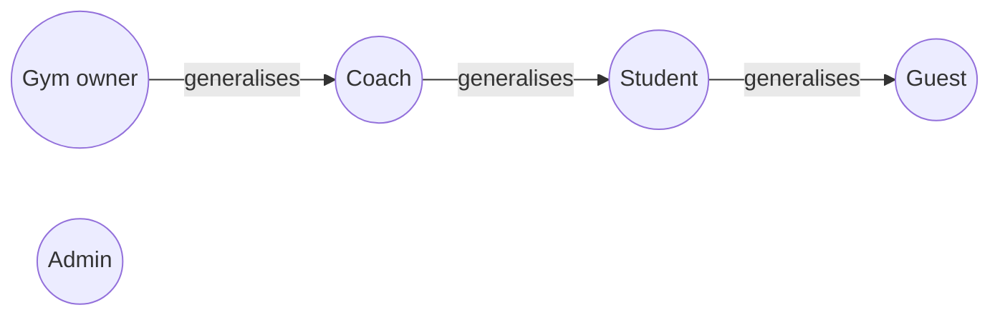
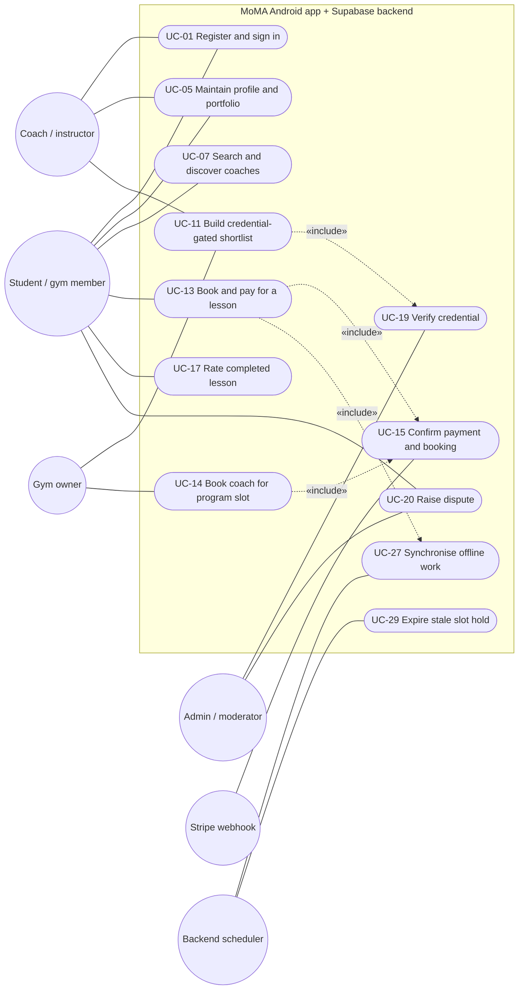
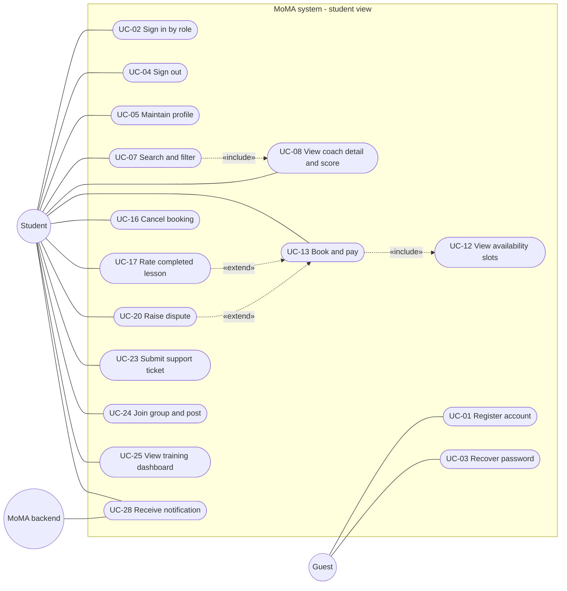
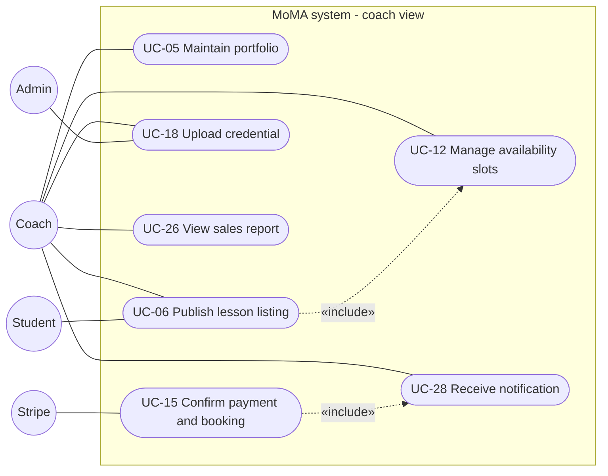
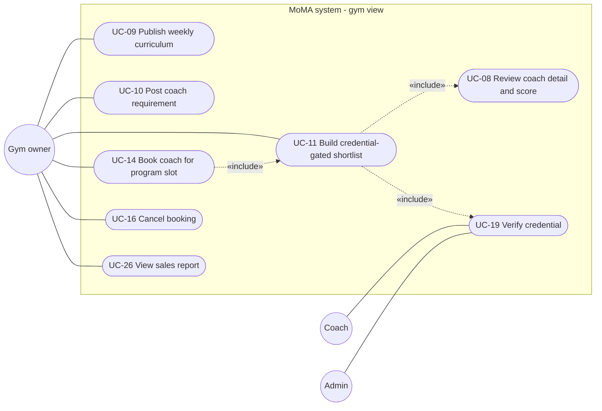
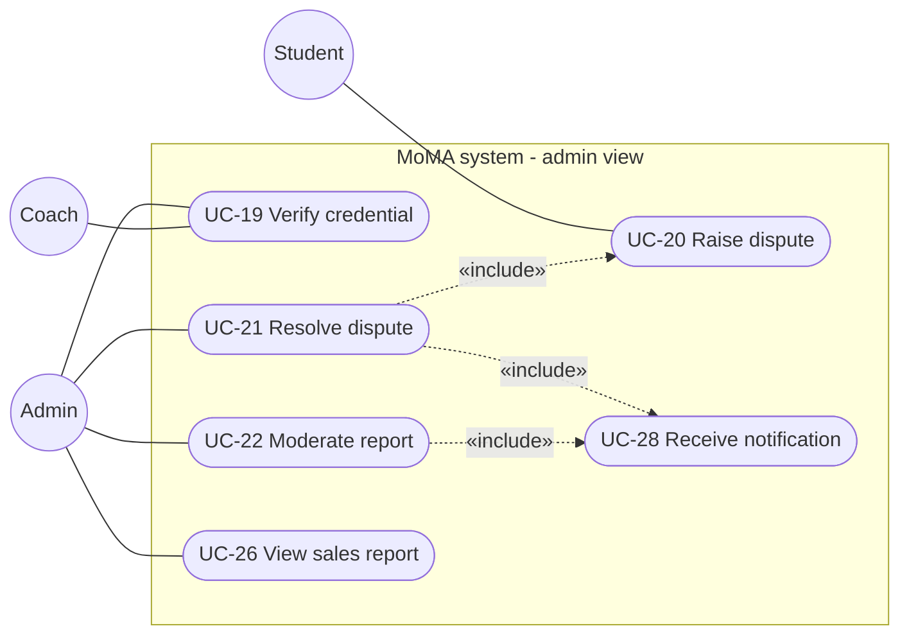
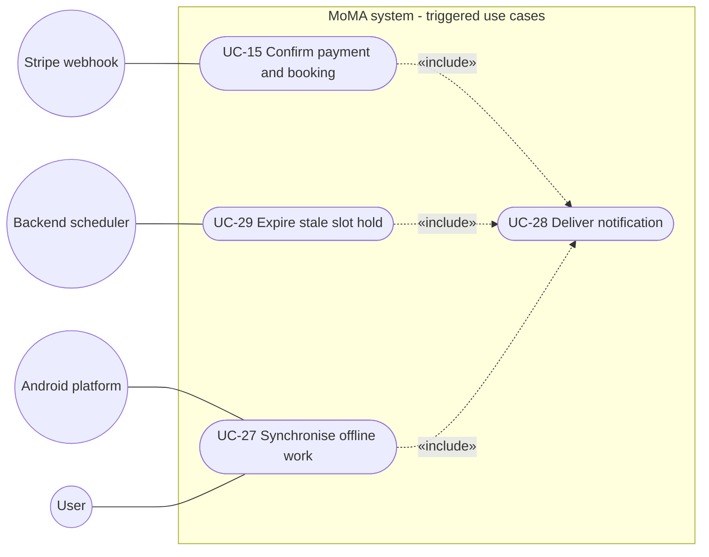

# MoMA — Use Case Document

| Field | Value |
|---|---|
| Product | MoMA (Masters of Martial Arts) — Android marketplace for martial arts coaching |
| Document version | 1.0 |
| Status | Proposed for implementation approval |
| Baseline | PRD v1.0, SRS v1.0, `Assignment2.pdf`, `MoMA_Android_App_Design.md`, `MoMA_Android_Solution.html` |
| Related documents | PRD (`01_…`), SRS (`02_…`), UX/UI Design Specs (`03_…`), SAD (`04_…`), DDD (`05_…`), API Documentation (`06_…`), `moma_openapi.yaml` |
| Diagram notation | Mermaid `flowchart` drawn as UML-style use cases (stable syntax; verified in Mermaid 11.16.0 and earlier). Circles = actors, stadium nodes = use cases, `subgraph` = system boundary, dashed labelled arrows = `«include»` / `«extend»`. |

> **Source convention.** **[Brief]** = traceable to the assignment PDF; **[Design]** = taken from the supplied design/solution artefacts; **[Proposed]** = introduced here for clarity and subject to confirmation. Requirement and user-story IDs refer to the PRD/SRS in this folder.

---

## 1. Purpose and scope

### 1.1 Purpose

This document describes *who* interacts with MoMA, *what* they try to achieve, and *how* the system behaves for each goal. It complements the SRS, which states requirements in "the system shall" form, by presenting the same behaviour as actor-goal scenarios with main, alternate and exception flows.

It is intended to support:

- Requirements review with the seminar stakeholder and the BJJ gym owner.
- Test-case derivation (each numbered step in a main flow is a candidate test assertion).
- Screen and API traceability: every use case maps to PRD user stories, SRS functional requirements and a documented endpoint/Edge Function.

### 1.2 In scope

- All four personas: student/gym member, coach/instructor, gym owner/program manager, admin/moderator. **[Brief + Design]**
- The gym-first beachhead: weekly Mon–Sun curriculum, four specialist coach requirements, credential gate, ruleset-aware booking. **[Design]**
- The general two-sided flows: discovery, checkout, bookings, reviews, community, analytics, trust/safety and support. **[Brief]**
- System-triggered and integration use cases: payment webhook, slot-hold expiry, offline outbox replay, push notification delivery. **[Design]**

### 1.3 Out of scope (no use case is written for these)

Consistent with PRD §5: iOS/web/desktop clients; storing card data locally; client-side payment or booking authorisation; offline payment authorisation; one-to-one messaging/live video; AI adjudication or automatic refunds; ads/subscription self-service UI; localisation beyond the delivered English UI; turn-by-turn navigation. Deferred capabilities (subscriptions, targeted advertising, Supabase Realtime threads) are documented as future notes, not as current use cases.

### 1.4 How to read the traceability fields

Each use case references:

- **US-…** — user story in PRD §3.
- **FR-…** — functional requirement in SRS §2.
- **BR-…** — business rule in SRS §2.12.
- **API** — operation in `06_API_Documentation.md` / `moma_openapi.yaml`.

---

## 2. Actors

### 2.1 Human actors

| ID | Actor | Type | Description | Principal goals | Source |
|---|---|---|---|---|---|
| A1 | Student / gym member | Primary | Beginner to advanced practitioner (persona P1, Aina) who discovers, books, pays for and reviews coaching | Find a verified coach, book and pay, track sessions, get help | **[Brief]** |
| A2 | Coach / instructor | Primary | Supply-side user (persona P2, Kenji) who publishes lessons and earns income | Publish listings, manage availability, get verified, get paid, build reputation | **[Brief]** |
| A3 | Gym owner / program manager | Primary (first customer) | Johor Bahru BJJ gym that needs four specialist coaches (persona P3) **[Design]** | Publish the weekly curriculum, shortlist credentialed coaches, fill four roles, book program sessions | **[Design]** |
| A4 | Admin / moderator | Secondary (trusted operator) | MoMA operations staff (persona P4) | Verify credentials, resolve disputes, moderate reports, monitor payouts | **[Design]** |
| A0 | Guest / unauthenticated visitor | Primary (pre-registration) | A visitor before sign-in | Register, recover password, read public marketing content | **[Brief]** |

**Role mapping.** The backend defines `STUDENT`, `INSTRUCTOR` and `ADMIN` role claims. The gym owner persona is implemented as an instructor-scoped gym capability rather than a fourth backend role, so A3 inherits A2's listing and availability rights plus additional gym-program rights. The Android client routes to the correct home after sign-in using the role claim; role claims also gate protected destinations. **[Design; SRS FR-AUTH-07/08]**

### 2.2 External system actors

| ID | System actor | Role in use cases | Source |
|---|---|---|---|
| ES1 | MoMA backend (Supabase Auth, PostgREST, Edge Functions, PostgreSQL/RLS, Storage) | Authenticates users, enforces ownership, runs matching/gate, creates bookings, stores media | **[Design]** |
| ES2 | Stripe / Stripe Connect | Tokenises cards, confirms PaymentIntents, sends webhooks, schedules coach payouts | **[Brief + Design]** |
| ES3 | Firebase Cloud Messaging (FCM) | Delivers booking, payment, dispute and forum notifications | **[Design]** |
| ES4 | Google / Facebook OAuth providers | Federated sign-in | **[Brief]** |
| ES5 | Android platform (WorkManager, Keystore, ConnectivityManager) | Schedules offline replay, secures tokens, reports network state | **[Design]** |

### 2.3 Actor relationships

> A1 → A2 → A3 expresses capability inheritance: a gym owner can perform coach actions plus gym-program actions. A4 is independent and is not a subtype of the marketplace roles.

---

## 3. Use case diagrams

Each diagram shows one actor view of the same system. They are drawn with Mermaid's stable `flowchart` syntax rather than the experimental `usecase-beta` parser, so they render in Mermaid 11.16.0 and earlier without syntax errors: circles represent actors, stadium nodes represent use cases, the `System` subgraph is the MoMA Android client plus its Supabase backend, and external actors sit outside it. Solid lines represent associations, arrows from an actor to a use case represent participation, and arrows between actors represent generalisation, and dashed arrows labelled `«include»` mean the included use case is always invoked while `«extend»` means the extension is optional and conditional.

### 3.1 UC-D1 — System context (all actors)

### 3.2 UC-D2 — Student / gym member view

### 3.3 UC-D3 — Coach / instructor view

### 3.4 UC-D4 — Gym owner / program manager view

> The dashed `<<include>>` from UC-11 to UC-19 models the dependency on *verification state*: the shortlist cannot be produced until the credential has been through the verification use case. The gym owner consumes that state; only the admin may perform the decision.

### 3.5 UC-D5 — Admin / moderator view

### 3.6 UC-D6 — System-triggered and integration view

---

## 4. Use case catalogue

Level: **S** = summary, **U** = user goal, **SF** = sub-function. The "Repo" column reflects the current local Android implementation described in `README.md` (mock/Room-backed), not the target production system.

| ID | Use case | Primary actor | Level | Priority / phase | PRD / SRS | API operation | Repo |
|---|---|---|---|---|---|---|---|
| UC-01 | Register account | Guest | U | Must / 1 | US-A01; FR-AUTH-01/03 | `POST /auth/v1/signup` | Sign-in screen |
| UC-02 | Sign in and route by role | A0/A1/A2/A3 | U | Must / 1 | US-A02; FR-AUTH-03/07 | `POST /auth/v1/token` | Implemented (mock role select) |
| UC-03 | Recover password | Guest | U | Must / 1 | US-A03; FR-AUTH-06 | `POST /auth/v1/recover` | Planned |
| UC-04 | Sign out | A0–A3 | SF | Must / 1 | US-A05; FR-AUTH-04 | Local token clear | Implemented |
| UC-05 | Maintain profile and portfolio | A1/A2 | U | Must / 1 | US-A04; FR-PROF-02/03/04 | `GET/PATCH /rest/v1/profiles` | Partial (profile) |
| UC-06 | Publish or edit lesson listing | A2 | U | Must / 1 | US-B04; FR-CAT-02/03 | `POST/PATCH /rest/v1/listings` | Planned |
| UC-07 | Search and filter coaches | A1/A3 | U | Must / 1 | US-B01/02/03; FR-DISC-01…04,06 | `POST /functions/v1/search` | Partial (local filter) |
| UC-08 | View coach detail and score breakdown | A1/A3 | U | Should / 2 | US-B05; FR-CAT-04, FR-DISC-05/07 | `GET /functions/v1/match-instructors` | Implemented (local ranking) |
| UC-09 | Publish weekly curriculum | A3 | U | Must / 1 | US-C07; FR-CAT-05 | `PATCH /rest/v1/gym_programs` | Partial (seed data) |
| UC-10 | Post coach requirement | A3 | U | Must / 1 | PRD F-05; FR-CAT-06 | `POST /rest/v1/gym_requirements` | Implemented (local) |
| UC-11 | Build credential-gated shortlist | A3 | U | Must / 1 | US-B06; FR-DISC-06/07 | `POST /functions/v1/match-instructors` | Implemented (domain gate) |
| UC-12 | Manage availability slots | A2 | U | Must / 1 | US-C01; FR-BOOK-01/02 | `GET/POST /rest/v1/availability_slots` | Partial (read only) |
| UC-13 | Book and pay for a lesson | A1 | U | Must / 1 | US-C01…C04; FR-BOOK-01…08 | `POST /functions/v1/create-booking` | Partial (local confirm) |
| UC-14 | Book coach for program slot | A3 | U | Must / 1 | US-C07; FR-BOOK-11 | `POST /functions/v1/create-booking` | Partial (local) |
| UC-15 | Confirm payment and booking | ES2 (webhook) | SF | Must / 1 | US-C04; FR-BOOK-05 | Stripe webhook → `confirm-booking` | Planned |
| UC-16 | Cancel booking and apply refund | A1/A3 | U | Should / 3 | US-C06; FR-BOOK-10 | `POST /functions/v1/cancel-booking` | Planned |
| UC-17 | Rate completed lesson | A1 | U | Must / 1 | US-D01; FR-REV-01…04 | `POST /rest/v1/reviews` | Planned |
| UC-18 | Upload credential and track status | A2 | U | Must / 1 | US-D05 (input); FR-PROF-05 | `POST /rest/v1/credentials` + Storage | Planned |
| UC-19 | Verify credential | A4 | U | Must / 3 | US-D05; FR-TRU-05/06 | `PATCH /rest/v1/credentials` (admin RLS) | Planned |
| UC-20 | Raise dispute | A1/A2/A3 | U | Should / 3 | US-D02; FR-TRU-01 | `POST /rest/v1/disputes` | Planned |
| UC-21 | Resolve dispute | A4 | U | Should / 3 | US-D06; FR-TRU-05 | `PATCH /rest/v1/disputes` | Planned |
| UC-22 | Report user or content | A1/A2/A3 | U | Should / 3 | US-D03; FR-TRU-02 | `POST /rest/v1/reports` | Planned |
| UC-23 | Submit support ticket | A1–A3 | U | Must / 1 | US-D04; FR-TRU-03/04 | `POST /rest/v1/support_tickets` | Planned |
| UC-24 | Join group and participate | A1/A2 | U | Should / 2 | US-E01/02; FR-COM-01…05 | `POST /rest/v1/posts`, `/comments`, `/likes` | Planned |
| UC-25 | View training dashboard | A1 | U | Should / 2 | US-E03/04; FR-ANA-01/02 | `GET /functions/v1/analytics/dashboard` | Planned |
| UC-26 | View sales report | A2/A3/A4 | U | Should / 3 | US-E05; FR-ANA-03/04 | `GET /functions/v1/reports/sales` | Planned |
| UC-27 | Synchronise offline work | ES5 | SF | Must / 1 | US-E02; FR-OFF-01…06 | Outbox replay via PostgREST | Partial (Room only) |
| UC-28 | Deliver and receive notification | ES3 / any user | U | Should / 2 | PRD F-14; FR-NOT-01…03 | `POST /functions/v1/notify` | Planned |
| UC-29 | Expire stale slot hold | Scheduler (ES1) | SF | Must / 1 | US-C05; FR-BOOK-06, BR-02 | Scheduled Edge Function / DB job | Planned |

---

## 5. Use case descriptions

### 5.1 Detailed specifications

#### UC-01 — Register account

| Field | Value |
|---|---|
| Primary actor | A0 Guest |
| Secondary actors | ES1 MoMA backend, ES4 OAuth provider |
| Goal | Create a MoMA account with an accepted privacy notice |
| Level / priority | User goal / Must, Phase 1 |
| Source | **[Brief]** wireframe area 1; US-A01; FR-AUTH-01/03; FR-PRV-01 |
| Preconditions | Device online; app installed; privacy notice available |
| Success end state | Supabase Auth user exists; a `profiles` row exists; consent timestamp recorded; user is authenticated |
| Failure end state | No account or incomplete profile row; validation or network error shown; no partial session |

**Main success scenario**

1. Guest opens the app and selects **Register**.
2. Guest enters full name, phone, email and password; client validates required fields and password policy.
3. Guest reads and accepts the privacy notice **[PDPA alignment — Design]**.
4. System calls `POST /auth/v1/signup` (or the selected OAuth provider flow) and receives a JWT + refresh token.
5. System creates the `profiles` row with the returned user id and records consent.
6. System stores the tokens in Keystore-backed storage and routes to the role-appropriate home.

**Alternate flows**

| Flow | At step | Condition | Outcome |
|---|---|---|---|
| A1 | 2 | Invalid field | Highlight field, block submit, remain on form |
| A2 | 4 | Email already registered | Show sign-in suggestion; no duplicate profile |
| A3 | 4 | Social sign-in selected | Delegate to ES4, then continue at step 5 |
| A4 | 5 | Token issued but profile insert fails | Retry with idempotency key; if still failing, show "complete setup" and allow retry |

**Exception flows**

| Flow | Condition | Outcome |
|---|---|---|
| E1 | No network | Show offline message; do not queue registration (account creation requires network) |
| E2 | Auth provider unavailable | Neutral error with retry; no partial account |

**Postconditions:** JWT in secure storage; profile row owned by the user; role claim available for routing. **Business rules:** FR-AUTH-01; FR-PRV-01/02. **Notes:** no password is written to Room/SQLite (NFR-SEC-05).

---

#### UC-02 — Sign in and route by role

| Field | Value |
|---|---|
| Primary actor | A0 / A1 / A2 / A3 |
| Secondary actors | ES1, ES4 |
| Goal | Resume an existing account and reach the correct home |
| Level / priority | User goal / Must, Phase 1 |
| Source | US-A02; FR-AUTH-03/04/05/07/08 |
| Preconditions | Account exists; device online or a valid cached session exists |
| Success end state | Valid session restored; user lands on student, coach/gym or admin home |
| Failure end state | User remains unauthenticated; tokens cleared |

**Main success scenario**

1. Actor opens the app and selects **Sign in**.
2. Actor enters email/password or chooses Google/Facebook.
3. System calls `POST /auth/v1/token`; ES1 returns JWT, refresh token and role claim.
4. System stores tokens in Keystore-backed storage.
5. System reads the role claim and navigates: `STUDENT` → student home, `INSTRUCTOR` (with gym capability) → gym home, `ADMIN` → admin console. **[Design]**
6. If a valid session already existed at launch, steps 1–4 are skipped and the actor starts at step 5.

**Alternate flows**

| Flow | At step | Condition | Outcome |
|---|---|---|---|
| A1 | 3 | Wrong credentials | Show generic authentication error; no account enumeration |
| A2 | 5 | Role claim missing/ambiguous | Default to student home and log a warning |

**Exception flows**

| Flow | Condition | Outcome |
|---|---|---|
| E1 | Token expired on restore | Silent refresh using refresh token; if refresh fails, show sign-in |
| E2 | Protected destination requested with insufficient role | Deny navigation, show "not available for your role" |

**Postconditions:** session valid; navigation stack appropriate to role. **Business rules:** FR-AUTH-07/08.

---

#### UC-03 — Recover password

| Field | Value |
|---|---|
| Primary actor | A0 Guest |
| Secondary actors | ES1 |
| Goal | Regain access after forgetting a password |
| Level / priority | User goal / Must, Phase 1 |
| Source | US-A03; FR-AUTH-06 |
| Preconditions | Device online |
| Success end state | Recovery email sent; user can set a new password via the emailed link |
| Failure end state | Neutral confirmation still shown; no account existence disclosed |

**Main flow:** Guest selects **Forgot password** → enters email → system calls `POST /auth/v1/recover` → system displays a neutral confirmation ("if the account exists, a link has been sent") → guest follows the link and sets a new password in the ES1-hosted flow.

**Alternate / exception:** invalid email format → block submission; provider error → show retry without revealing account existence. **Postconditions:** no session created by recovery alone. **Business rule:** neutral response is mandatory to prevent account enumeration.

---

#### UC-04 — Sign out

**Actor:** A0–A3. **Source:** US-A05; FR-AUTH-04. **Main flow:** actor opens Profile → selects **Sign out** → system removes access/refresh tokens from Keystore-backed storage, clears cached private Room data where required, and shows the unauthenticated graph. **Alternate:** offline → local sign-out still succeeds; remote sessions are invalidated by token expiry when connectivity returns. **Postcondition:** no authenticated navigation destination is reachable.

---

#### UC-05 — Maintain profile and portfolio

| Field | Value |
|---|---|
| Primary actor | A1 Student or A2 Coach |
| Secondary actors | ES1 (Storage + PostgREST), ES5 |
| Goal | Keep personal and professional information accurate and visible |
| Level / priority | User goal / Must, Phase 1 |
| Source | US-A04; FR-PROF-01…06; FR-OFF-03/04 |
| Preconditions | Authenticated; profile row exists |
| Success end state | Own profile/portfolio updated; public portfolio shows badge only for verified credentials |
| Failure end state | Local draft retained in outbox for retry |

**Main success scenario**

1. Actor opens **Profile** and selects **Edit**.
2. Actor edits allowed fields: name, bio, contact, city, avatar; a coach additionally edits styles, experience, qualifications, hourly rate and media.
3. Client validates fields and MIME/size allowlists for media (image ≤ 10 MB, video ≤ 100 MB).
4. System writes the change locally and calls `PATCH /rest/v1/profiles` (and Storage for media).
5. ES1/RLS confirms the row belongs to the actor; update is committed.
6. System refreshes the local Room copy and displays the verification badge only when all required credentials are `VERIFIED`.

**Alternate flows**

| Flow | At step | Condition | Outcome |
|---|---|---|---|
| A1 | 4 | Offline | Write to outbox with idempotency key; show "saved on device" banner; replay later (UC-27) |
| A2 | 5 | Concurrent edit elsewhere | Apply field-level last-write-wins per FR-OFF-04; show refreshed values |
| A3 | 6 | Credential pending/rejected | Badge withheld; show credential status in portfolio |

**Exception flows:** upload rejected by allowlist → reject file and keep the rest of the draft; RLS denial → discard local optimistic value. **Postconditions:** owner-only data changed; no secrets stored locally.

---

#### UC-06 — Publish or edit a lesson listing

| Field | Value |
|---|---|
| Primary actor | A2 Coach |
| Secondary actors | ES1, A1 Student (consumer of result) |
| Goal | Make a bookable lesson discoverable |
| Level / priority | User goal / Must, Phase 1 |
| Source | US-B04; FR-CAT-02/03; BR-01 |
| Preconditions | Authenticated as `INSTRUCTOR`; at least one credential on file (verification not required to create, but required to be promoted/shortlisted) |
| Success end state | Active listing visible in search with price and style |
| Failure end state | Listing remains draft/inactive with validation errors |

**Main success scenario**

1. Coach opens **Instructor workspace → Listings** and selects **New listing**.
2. Coach supplies title, style, ruleset, level, duration, price (MYR), city, description and optional image.
3. System validates required fields and that the style is one of the six focus styles **[Design]**.
4. System calls `POST /rest/v1/listings` with owner id; RLS restricts write to owner.
5. ES1 persists the listing; system refreshes Room and shows **Published**.
6. Coach sets availability slots (UC-12), which completes listing readiness.

**Alternate flows:** edit/deactivate existing listing → `PATCH` with same owner check; offline → queue with idempotency key, publish on replay. **Exception flows:** server rejects ruleset/style combination → show field error; unauthorised owner → deny with RLS error. **Postconditions:** listing row owned by coach; commission rule BR-01 resolved server-side at checkout, not stored on the client.

---

#### UC-07 — Search and filter coaches

| Field | Value |
|---|---|
| Primary actor | A1 Student or A3 Gym owner |
| Secondary actors | ES1 |
| Goal | Find relevant, eligible coaches quickly |
| Level / priority | User goal / Must, Phase 1 |
| Source | US-B01/02/03; FR-DISC-01…04,06 |
| Preconditions | Catalogue available; online for fresh results (cached results allowed offline) |
| Success end state | Ranked result list displayed, with saved-data banner if offline |
| Failure end state | Empty state with filter-reset suggestion |

**Main success scenario**

1. Actor opens **Search** and types at least two characters.
2. System debounces input and requests autocomplete suggestions (styles, cities, coach names).
3. Actor selects filters: style, city, price, rating, availability; a gym owner additionally selects **verified credential** and **ruleset** (ADCC / ACBJJ Battle Jiu-Jitsu).
4. System calls `POST /functions/v1/search`; ES1 applies the mandatory credential/ruleset gate before any scoring (FR-DISC-06, BR-04).
5. System writes results to Room before screens observe them (FR-OFF-01) and renders the list.
6. Actor selects a result → UC-08.

**Alternate flows:** offline → show cached Room results with "saved data" banner; no matches → offer to relax filters; gym owner selects unverified coach → candidate excluded with reason if the gate's diagnostic view is enabled. **Exception flows:** search function timeout → show retry; rate limiting → back off and show retry. **Postconditions:** results cached locally; no other users' private fields exposed.

---

#### UC-08 — View coach detail and score breakdown

**Actors:** A1 Student / A3 Gym owner; ES1. **Source:** US-B05; FR-CAT-04; FR-DISC-05/07. **Goal:** evaluate a coach and understand why they were recommended.

**Main flow:** actor opens a result → system renders hero image, bio, styles, qualifications, verification state, rating, reviews and availability → for gym users the system displays the gate result and score factor breakdown (style 30, credential depth 25, availability 15, distance 10, rating 10, price 10 **[Design]**; the SRS also records the generic weighting variant style 30 / availability 25 / distance 15 / rating 15 / price 10 / verification 5 — the gym-first weighting takes precedence for requirement matching) → actor chooses **Book** (UC-13/UC-14) or returns to search.

**Alternate flows:** credential pending → show "not eligible" reason and disable gym booking while allowing general student booking where policy permits; photos fail to load → placeholder and retry. **Postconditions:** no booking created by viewing. **Business rule:** rejected coaches may be displayed with an exact rejection reason so a hiring decision can be defended **[Design]**.

---

#### UC-09 — Publish weekly curriculum

| Field | Value |
|---|---|
| Primary actor | A3 Gym owner |
| Secondary actors | ES1 |
| Goal | Maintain the Mon–Sun programme that drives coach demand |
| Level / priority | User goal / Must, Phase 1 (beachhead) |
| Source | PRD F-05; FR-CAT-05 |
| Preconditions | Authenticated with gym capability |
| Success end state | Seven-day curriculum published with style and ruleset per day |
| Failure end state | Previous published version retained |

**Main flow:** gym owner opens **Gym home → Weekly curriculum** → reviews the seven days (Mon BJJ Gi/IBJJF; Tue BJJ No-Gi/ADCC; Wed Judo; Thu Wrestling/ADCC; Fri Kyokushin + Muay Thai/ACBJJ Battle Jiu-Jitsu; Sat BJJ Gi open mat; Sun BJJ No-Gi open mat **[Design]**) → edits style, ruleset, coach assignment and staffing state per day → system calls `PATCH /rest/v1/gym_programs` with RLS owner check → system refreshes the coverage KPIs on Gym home.

**Alternate flows:** offline edit → local draft + outbox replay (UC-27); day already assigned → warn before replacing coach assignment. **Exception:** conflicting concurrent edit → server wins and UI refreshes. **Postconditions:** curriculum rows updated; open requirements reflect the new programme.

---

#### UC-10 — Post coach requirement

**Actors:** A3 Gym owner; ES1. **Source:** PRD F-05; FR-CAT-06. **Goal:** advertise a specialist role with an enforceable credential gate.

**Main flow:** gym owner opens **Requirements → New role** → enters program day, style, required credential (e.g. Judo black belt), minimum years, ruleset experience (e.g. ADCC or ACBJJ Battle Jiu-Jitsu), budget and start date → system validates the required credential/ruleset pair → system calls `POST /rest/v1/gym_requirements` → requirement appears as **Open** in Gym home coverage KPIs.

**Alternate flows:** edit an open requirement → `PATCH`; close a filled requirement → status `FILLED`; offline → queue write. **Exception:** required credential not in the allowlist → block with a selection prompt. **Postconditions:** requirement row owned by gym; UC-11 can evaluate candidates against it.

---

#### UC-11 — Build credential-gated shortlist

| Field | Value |
|---|---|
| Primary actor | A3 Gym owner |
| Secondary actors | A2 Coach, ES1, A4 Admin (verification state owner) |
| Goal | See only coaches eligible for an open requirement, with a defensible ranking |
| Level / priority | User goal / Must, Phase 1 (beachhead) |
| Source | US-B06; FR-DISC-05/06/07; FR-CAT-06; BR-04 |
| Preconditions | At least one open requirement; candidates have profile/credential data; admin has processed verifications (UC-19) |
| Success end state | Shortlist of eligible coaches with score breakdown; rejected candidates listed with reasons |
| Failure end state | Empty shortlist with explanation of which gate criterion eliminated candidates |

**Main success scenario**

1. Gym owner selects an open requirement (e.g. Wed Judo black belt).
2. System calls `POST /functions/v1/match-instructors` with the requirement id.
3. For each candidate, ES1 applies the hard gate in order: style match → **verified** credential → minimum experience → ruleset experience → identity verified. **[Design; README §2]**
4. Candidates failing any criterion are excluded from scoring and tagged with the exact rejection reason.
5. Surviving candidates are scored (style 30, credential depth 25, availability 15, distance 10, rating 10, price 10 **[Design]**).
6. System caches the ranked result into Room and renders the shortlist with a score bar and factor breakdown.
7. Gym owner opens a coach (UC-08) or books them (UC-14).

**Alternate flows**

| Flow | At step | Condition | Outcome |
|---|---|---|---|
| A1 | 3 | Credential uploaded but pending | Reject with "uploaded but not verified"; admin queue is notified |
| A2 | 3 | No credential on file | Reject with "no credential on file" |
| A3 | 5 | Tie score | Deterministic secondary sort by distance then rating |
| A4 | 6 | Offline | Show last cached shortlist with "saved data" banner |

**Exception flows:** matching function error → retry with backoff; requirement deleted mid-request → abandon with message. **Postconditions:** no unverified coach reaches the shortlist (PRD acceptance criterion 10). **Business rule:** BR-04 credential must be verified before shortlisting and payout.

---

#### UC-12 — Manage availability slots

**Actors:** A2 Coach; secondary A1 Student / A3 Gym owner (readers), ES1. **Source:** US-C01; FR-BOOK-01/02. **Goal:** publish when and under which ruleset a coach can teach.

**Main flow:** coach opens **Availability** → selects a date and time → chooses ruleset (Gi, No-Gi, ADCC, ACBJJ Battle Jiu-Jitsu, open mat) and duration → system calls `POST /rest/v1/availability_slots` → slot is stored as `FREE`; student/gym views show FREE / HELD / BOOKED with the ruleset label.

**Alternate flows:** block/remove a slot that has no booking → delete; slot already HELD/BOOKED → warn, require cancellation first; offline → queue creation. **Exception:** overlapping slot → reject with conflict message. **Postconditions:** slot row with state and ruleset; UC-13/UC-14 can atomically place a hold on a `FREE` slot.

---

#### UC-13 — Book and pay for a lesson

| Field | Value |
|---|---|
| Primary actor | A1 Student |
| Secondary actors | A2 Coach, ES1 MoMA backend, ES2 Stripe |
| Goal | Secure a lesson slot and pay safely |
| Level / priority | User goal / Must, Phase 1 |
| Source | US-C01…C04; FR-BOOK-01…08,12; BR-01/02/05/07; wireframe area 7 |
| Preconditions | Authenticated; listing active; at least one `FREE` slot; network available; Stripe SDK initialised |
| Success end state | Booking `CONFIRMED`, slot `BOOKED`, PaymentIntent succeeded, commission recorded, payout scheduled |
| Failure end state | Slot released to `FREE`; no charge retained without a confirmed booking |

**Main success scenario**

1. Student selects a coach from search/detail and chooses an available slot (`FREE`, with ruleset shown).
2. System calls `POST /functions/v1/create-booking`; in one transaction ES1 checks the slot, sets it to `HELD` (10-minute hold) and creates a `PENDING_PAYMENT` booking.
3. ES1 resolves the commission (10–20%, server-side) and creates a Stripe PaymentIntent with `application_fee_amount`; the order summary shows price, coach, ruleset, time, venue and included service fee.
4. Student completes the 4-step checkout **Lesson → Slot → Payment → Review** and confirms the card through the Stripe Android SDK. No PAN/CVV is sent to MoMA endpoints.
5. ES2 sends `payment_intent.succeeded` to the webhook; UC-15 sets the booking to `CONFIRMED`, slot to `BOOKED` and schedules a Connect payout.
6. Client syncs the server state and shows the confirmed booking in **Bookings → Upcoming**; local optimistic state is replaced by the server state.

**Alternate flows**

| Flow | At step | Condition | Outcome |
|---|---|---|---|
| A1 | 2 | Slot became HELD/BOOKED concurrently | Atomic check fails; show "slot taken", offer next available slot |
| A2 | 4 | Card declined | Show Stripe decline message; hold remains until expiry (UC-29) |
| A3 | 4 | Student abandons checkout | Hold expires after 10 minutes; booking marked failed/cancelled |
| A4 | 5 | Webhook delayed | Show `PENDING` with "payment processing" until server confirmation; never confirm locally |
| A5 | 6 | App offline at confirmation | Show locally pending state; refresh on reconnect; server remains authoritative |

**Exception flows**

| Flow | Condition | Outcome |
|---|---|---|
| E1 | PaymentIntent creation fails | Release hold, no booking charge, show retry |
| E2 | Duplicate submit / replayed request | Idempotency key prevents a second booking or charge |
| E3 | Commission rule missing | Server defaults to configured rate and logs an error; client never computes commission |

**Postconditions:** booking `CONFIRMED`; slot `BOOKED`; `bookings.commission_cents` recorded; payout scheduled; notification (UC-28). **Business rules:** BR-01, BR-02, BR-05, BR-07. **Notes:** NFR-PERF-04 ≤ 2 s p95 for booking + PaymentIntent; NFR-SEC-09 webhook-only confirmation **[Proposed targets]**.

---

#### UC-14 — Book coach for program slot

**Actors:** A3 Gym owner; secondary A2 Coach, ES1, ES2. **Source:** US-C07; FR-BOOK-11. **Goal:** staff a curriculum day with the correct specialist and ruleset.

**Main flow:** gym owner selects a day in the weekly curriculum (e.g. Thu Wrestling/ADCC) → the system reuses UC-11 to confirm eligibility → owner chooses a shortlisted coach and slot → system creates the booking with `ruleset` and `program_day` stored on the booking **[Design]** → checkout follows UC-13 steps 2–6 with the gym's 15% commission example shown at checkout **[Design]** → booking is `CONFIRMED` and the day's coverage KPI updates.

**Alternate flows:** selected coach becomes ineligible (credential revoked) → block with reason and return to shortlist; slot conflict → offer alternatives; offline → block booking (payment requires network). **Exception:** ruleset mismatch between requirement and slot → reject with "ruleset mismatch" and require correction. **Postconditions:** confirmed program booking with ruleset/day; coach availability updated; requirement may be marked `FILLED`.

---

#### UC-15 — Confirm payment and booking

| Field | Value |
|---|---|
| Primary actor | ES2 Stripe webhook (system-triggered) |
| Secondary actors | ES1, A1/A3 (notification recipients) |
| Goal | Make payment and booking state authoritative without trusting the client |
| Level / priority | Sub-function / Must, Phase 1 |
| Source | US-C04; FR-BOOK-05; BR-07; NFR-SEC-09 |
| Preconditions | PaymentIntent exists; webhook signature verified |
| Success end state | Booking `CONFIRMED`, slot `BOOKED`, payout scheduled, notification triggered |
| Failure end state | Booking remains `PENDING_PAYMENT`/`FAILED`; slot released |

**Main flow:** ES2 posts `payment_intent.succeeded` → ES1 verifies the signature and idempotency key → Edge Function looks up the booking by PaymentIntent id → sets booking `CONFIRMED` → sets slot `BOOKED` → records commission and schedules Stripe Connect payout → enqueues FCM notification (UC-28) → client syncs on next reconnect/refresh.

**Alternate flows:** `payment_intent.payment_failed` → release slot, mark booking `FAILED`, notify user; duplicate webhook → no-op via idempotency; webhook for unknown booking → log and return 404. **Exception:** invalid signature → reject with 400 and alert. **Postconditions:** only server-originated confirmation exists; client cannot forge a confirmed booking.

---

#### UC-16 — Cancel booking and apply refund

**Actors:** A1 Student or A3 Gym owner; ES1, ES2. **Source:** US-C06; FR-BOOK-10. **Goal:** cancel consistently under the published refund policy.

**Main flow:** actor opens **Bookings** → selects a `CONFIRMED` booking → chooses **Cancel** → reviews policy and confirms → system calls `POST /functions/v1/cancel-booking` → server applies refund rules, sets booking `CANCELLED`, frees the slot and records the refund → FCM notification sent.

**Alternate flows:** outside refund window → show policy outcome before confirmation; dispute open → block cancellation until resolution (UC-21); offline → block (server-authoritative). **Exception:** Stripe refund API failure → keep booking `CANCEL_PENDING`, retry with idempotency. **Postconditions:** no client can change status directly (BR-07); refund recorded server-side.

---

#### UC-17 — Rate completed lesson

| Field | Value |
|---|---|
| Primary actor | A1 Student |
| Secondary actors | ES1, A2 Coach (review subject) |
| Goal | Share trustworthy feedback after a completed lesson |
| Level / priority | User goal / Must, Phase 1 |
| Source | US-D01; FR-REV-01…05; BR-03; wireframe area 9 |
| Preconditions | Booking status `COMPLETED` for the same student/instructor pair; no existing review for that booking |
| Success end state | Review visible on the coach profile; one review per booking |
| Failure end state | Draft retained locally with validation errors |

**Main flow:** student opens **Bookings → Completed** → selects **Review** → sets 1–5 stars, optional quick tags, text and optional image/video → system validates allowlisted MIME types and sizes → system calls `POST /rest/v1/reviews` with `booking_id` unique constraint → ES1 persists → coach profile rating summary refreshes.

**Alternate flows:** offline → write review locally and queue media upload (UC-27); dispute blocks review → show "available after dispute resolution" (FR-REV-05); duplicate review attempt → blocked by unique `booking_id`. **Exception:** media upload rejected → text review still submits, media error reported. **Postconditions:** immutable one-per-booking review; no review without a completed booking.

---

#### UC-18 — Upload credential and track status

**Actors:** A2 Coach; secondary A4 Admin, ES1 (Storage). **Source:** US-D05 (input side); FR-PROF-05; credential state model in SRS §3.2. **Goal:** prove qualification and become eligible for gym shortlists and payouts.

**Main flow:** coach opens **Instructor workspace → Credentials** → selects credential type (e.g. Judo black belt, wrestling record, Kyokushin dan, Muay Thai certification), issues/issuer and ruleset experience → uploads a document image (allowlisted MIME, ≤ 10 MB) → system stores the object in Supabase Storage and writes a `credentials` row with status `PENDING` → coach sees **Under review** and can resubmit if rejected.

**Alternate flows:** rejected → coach edits and resubmits (`REJECTED → PENDING`); offline → queue upload with idempotency key. **Exception:** file too large or wrong type → block with clear message. **Postconditions:** credential in `PENDING`; badge withheld until UC-19 approves. **Business rule:** BR-04 credential must be verified before shortlisting and payout.

---

#### UC-19 — Verify credential

| Field | Value |
|---|---|
| Primary actor | A4 Admin |
| Secondary actors | A2 Coach (subject), A3 Gym owner (consumer of verified state) |
| Goal | Ensure only qualified coaches appear on shortlists and receive payouts |
| Level / priority | User goal / Must, Phase 3 |
| Source | US-D05; US-D06; FR-TRU-05/06; FR-PROF-05; BR-04; NFR-SEC-07 |
| Preconditions | Admin role claim; credential in `PENDING` or `UNDER_REVIEW`; document available |
| Success end state | Credential `VERIFIED` or `REJECTED` with an auditable decision |
| Failure end state | Credential remains `UNDER_REVIEW` |

**Main flow:** admin opens **Admin console → Verification queue** → opens a case → inspects the uploaded document against allowlisted issuers and the claimed style/ruleset → records a decision and reason → system calls `PATCH /rest/v1/credentials` under admin-only RLS → state changes `PENDING → UNDER_REVIEW → VERIFIED` (or `REJECTED`) → audit entry written → coach's profile badge and any affected shortlists refresh.

**Alternate flows:** insufficient evidence → request resubmission with reason; already verified credential flagged later → reopen case and revoke. **Exception:** non-admin attempts decision → RLS denies and logs. **Postconditions:** verified flag drives UC-11 gate and payout eligibility; decision attributable to admin.

---

#### UC-20 — Raise dispute

**Actors:** A1 Student / A2 Coach / A3 Gym owner; ES1, A4 Admin (downstream). **Source:** US-D02; FR-TRU-01/04/05. **Goal:** challenge a payment or service problem with evidence.

**Main flow:** actor opens the relevant booking → selects **Raise dispute** → chooses reason, enters details and attaches evidence (image/video) → system calls `POST /rest/v1/disputes` referencing the booking → ticket status `OPEN`, visible only to the reporter and admins → FCM notification to admin queue (UC-28).

**Alternate flows:** offline → save locally and replay via UC-27; duplicate dispute for same booking → show existing ticket instead of creating another. **Exception:** invalid evidence type → reject attachment, keep text. **Postconditions:** auditable ticket; booking may be flagged `DISPUTED` per SRS state model; review blocked until resolution (FR-REV-05).

---

#### UC-21 — Resolve dispute

**Actors:** A4 Admin; secondary reporter, coach, ES2. **Source:** US-D06; FR-TRU-05/06. **Goal:** close a dispute with a defensible, auditable outcome.

**Main flow:** admin opens **Admin console → Disputes** → reviews booking, messages and evidence → records decision (`RESOLVED_FOR_INSTRUCTOR` → booking back to `CONFIRMED`, or `REFUNDED` → booking `CANCELLED` and Stripe refund) → system writes status and audit entry → notification sent to both parties (UC-28).

**Alternate flows:** need more information → request from reporter and keep queue item open; refund API failure → mark `REFUND_PENDING` and retry idempotently. **Exception:** non-admin access → denied by RLS. **Postconditions:** dispute closed with recorded decision; affected booking state consistent; no automatic AI adjudication (PRD §5).

---

#### UC-22 — Report user or content

**Actors:** A1/A2/A3 reporter; secondary A4. **Source:** US-D03; FR-TRU-02/05. **Main flow:** actor selects **Report** on a profile/listing/post → chooses one of seven reasons (spam, hate speech, false information, adult content, violence, IP violation, other) → adds details → system calls `POST /rest/v1/reports` → admin moderation queue receives the case. **Alternate:** offline draft queued via UC-27. **Exception:** duplicate report on same content by same user → merge/show existing. **Postconditions:** report visible to reporter and admins only (NFR-PRV-05).

---

#### UC-23 — Submit support ticket

**Actors:** A1/A2/A3; ES1. **Source:** US-D04; FR-TRU-03/04; wireframe area 12. **Goal:** get help through a tracked channel.

**Main flow:** actor opens **Support** → enters subject, issue description, email and phone, optionally attaches an image → system validates fields → system calls `POST /rest/v1/support_tickets` → confirmation with ticket reference → actor can also see email/phone/chat contact options **[Design: "chat" is a contact channel, not a messaging product]**.

**Alternate flows:** offline → draft queued with idempotency key (UC-27); image too large → reject image, keep ticket. **Postconditions:** ticket stored with owner scoping; PDPA-aligned data minimisation (only required fields).

---

#### UC-24 — Join group and participate

**Actors:** A1/A2; ES1. **Source:** US-E01/02; FR-COM-01…05. **Goal:** learn and discuss with peers.

**Main flow:** actor opens **Community** → browses Suggested / Your groups / Near you → joins a group → reads rules and member list → creates a post with text/media, comments or likes → system optimistically updates the UI, writes locally and calls the corresponding PostgREST endpoint.

**Alternate flows:** offline → local draft + outbox replay with idempotency key; non-member attempts to read feed → RLS denies and shows join prompt; post rejected by moderation → author sees removal reason. **Exception:** replay conflict → field-level last-write-wins for text. **Postconditions:** feed content visible only to group members; optimistic changes reconciled with server.

---

#### UC-25 — View training dashboard

**Actors:** A1; ES1. **Source:** US-E03/04; FR-ANA-01/02. **Goal:** understand training volume and progress.

**Main flow:** student opens **Dashboard** → selects Today / Week / Month → system calls `GET /functions/v1/analytics/dashboard` → renders stat cards and chart for sessions, duration, intensity and estimates → student toggles and reorders widgets; preferences stored locally and synced.

**Alternate flows:** offline → show last cached aggregates; empty history → onboarding empty state. **Exception:** analytics function error → retry with backoff. **Postconditions:** no raw payment data delivered to client (FR-ANA-04).

---

#### UC-26 — View sales report

**Actors:** A2 Coach / A3 Gym owner / A4 Admin; ES1. **Source:** US-E05; FR-ANA-03/04. **Goal:** track revenue, commission, booking trends and payouts.

**Main flow:** actor opens **Reports → Sales** → selects period → system calls `GET /functions/v1/reports/sales` → ES1 returns server-generated aggregates (gross, commission, trends, payout summary) → actor views the report; coach/admin only see rows they are authorised for under RLS.

**Alternate flows:** no sales in period → empty state; offline → cached aggregates with "saved data" banner. **Postconditions:** no raw card data or other users' private payment data on device.

---

#### UC-27 — Synchronise offline work

| Field | Value |
|---|---|
| Primary actor | ES5 Android platform (WorkManager, triggered by connectivity) |
| Secondary actors | A1/A2/A3 (originating user), ES1 |
| Goal | Replay offline mutations without losing data or duplicating writes |
| Level / priority | Sub-function / Must, Phase 1 |
| Source | FR-OFF-01…06; US-E02; NFR-AVA-05 |
| Preconditions | Outbox contains queued mutations with idempotency keys; connectivity restored |
| Success end state | Outbox drained; Room mirrors server state |
| Failure end state | Failed items retained with retry count; user warned after repeated failure |

**Main flow:** WorkManager detects network → reads outbox ordered by created_at → for each item, calls the corresponding PostgREST/Edge Function with its idempotency key → applies conflict policy (server wins for bookings/payments; field-level last-write-wins for profile/post text) → writes server response into Room → removes the outbox item.

**Alternate flows:** 401 → refresh token then retry; 409 conflict → apply policy and drop local stale value; still offline → reschedule. **Exception:** repeated failure → keep item, increment counter, alert per NFR-OBS-03 **[Proposed]**. **Postconditions:** no duplicate booking/review/payment; no payment write is ever queued offline (BR-05).

---

#### UC-28 — Deliver and receive notification

**Actors:** ES3 FCM (sender), any authenticated user (recipient), ES1. **Source:** PRD F-14; FR-NOT-01…03. **Goal:** inform users of events needing attention.

**Main flow:** a triggering use case (UC-15, UC-16, UC-21, UC-24) enqueues a notification → system calls `POST /functions/v1/notify` → ES3 delivers push → user taps it → app deep-links to Bookings, Disputes or the forum thread → unread state cleared.

**Alternate flows:** app in foreground → in-app banner instead of push; permission not granted → show in-app only and request permission just-in-time; offline device → FCM delivery on reconnect per platform behaviour. **Postconditions:** deep link resolves to the correct role-aware destination; no sensitive payment details in the notification payload.

---

#### UC-29 — Expire stale slot hold

**Actors:** ES1 scheduler (system-triggered); secondary A1/A2/A3. **Source:** US-C05; FR-BOOK-06; BR-02. **Goal:** prevent abandoned checkouts from blocking inventory.

**Main flow:** scheduler runs every minute → finds slots `HELD` longer than 10 minutes → in one transaction releases the slot to `FREE` and marks the related booking `FAILED`/`CANCELLED` → enqueues notification if a user was waiting.

**Alternate flows:** payment succeeds just before expiry → UC-15 wins and slot becomes `BOOKED`; scheduler lag → expiry may occur slightly late but never before 10 minutes. **Exception:** transaction failure → retry next cycle. **Postconditions:** no slot remains held indefinitely; no charge without a confirmed booking.

---

## 6. Use case relationship summary

| Use case | Includes (always) | Extends (conditional) | Triggered by |
|---|---|---|---|
| UC-07 Search | UC-08 Coach detail | — | A1/A3 |
| UC-11 Shortlist | UC-08 Coach detail; verification state from UC-19 | — | A3 |
| UC-13 Book and pay | UC-12 Availability; UC-15 Confirm; UC-27 Sync | UC-17 Review; UC-20 Dispute | A1 |
| UC-14 Gym booking | UC-11 Shortlist; UC-15 Confirm | — | A3 |
| UC-15 Confirm | UC-28 Notification | — | Stripe webhook (ES2) |
| UC-16 Cancel | UC-28 Notification | — | A1/A3 |
| UC-17 Review | — | Extends booking lifecycle | A1 |
| UC-19 Verify | — | — | A4 |
| UC-21 Resolve dispute | UC-20 Raise dispute; UC-28 Notification | — | A4 |
| UC-22 Moderate report | UC-28 Notification | — | A4 |
| UC-27 Sync | UC-28 Notification (on notable failures) | — | WorkManager (ES5) |
| UC-29 Expire hold | UC-28 Notification (optional) | — | Scheduler (ES1) |

---

## 7. Traceability summary

| Brief wireframe area | Use cases |
|---|---|
| 1. Authentication | UC-01, UC-02, UC-03, UC-04 |
| 2. Profiles & portfolio | UC-05, UC-18, UC-19 |
| 3. Listings & content management | UC-06, UC-09, UC-10 |
| 4. Search & discovery | UC-07, UC-08 |
| 5. Forums & groups | UC-24 |
| 6. Matching algorithm | UC-11 |
| 7. Payments & transactions | UC-12, UC-13, UC-14, UC-15, UC-16, UC-29 |
| 8. Disputes | UC-20, UC-21 |
| 9. Ratings & reviews | UC-17 |
| 10. Dashboard analytics | UC-25 |
| 11. Reporting | UC-22, UC-26 |
| 12. Support page | UC-23 |
| 13. Mobile device accessibility | Cross-cutting: all use cases inherit NFR-ACC-01…06 (48 dp targets, TalkBack labels, text scaling, status not by colour alone) |

---

## 8. Assumptions and open questions

| # | Item | Status |
|---|---|---|
| 1 | Gym owner is an instructor-scoped capability, not a fourth backend role | Confirmed in supplied design **[Design]** |
| 2 | Two matching weight sets appear in the sources; gym-first weights (30/25/15/10/10/10) take precedence for requirement matching | **[Design]** — confirm with stakeholder |
| 3 | 10-minute hold, 10–20% commission, 15% gym example rate | **[Design]** — commercial confirmation needed |
| 4 | Refund policy windows are not specified in the brief; UC-16 defers to server-side policy | **[Proposed]** — needs operations decision |
| 5 | Dispute/refund retention (24 months after closure) | **[Proposed]** — needs operations confirmation (SRS NFR-PRV-04) |
| 6 | Push notification payload must contain no sensitive payment data | **[Proposed]** security rule |
| 7 | "Chat" in Support is a contact channel, not a messaging product | Explicitly out of scope in PRD §5.1 |
| 8 | Current repository implements Room/mock flows only; payment, FCM, outbox replay, coach workspace and admin queues are planned | See `README.md §6` — this document describes the target system |

---

## Appendix A — Diagram source notes

All five actor views plus the system-triggered view are Mermaid `flowchart` blocks in §2.3 and §3.1–§3.6. They intentionally avoid the experimental `usecase-beta` diagram type because its parser rejected these diagrams in Mermaid 11.16.0. To export them as images, paste each block into [Mermaid Live Editor](https://mermaid.live/) or any Markdown renderer with Mermaid support and export as SVG/PNG. Actor nodes (e.g. `GymOwner`, `StripeWebhook`, `Scheduler`) map to A3, ES2 and the backend scheduler respectively, as listed in §2. The `System` subgraph is the MoMA client plus its Supabase backend; dashed arrows labelled `«include»` / `«extend»` preserve the UML use-case semantics.
