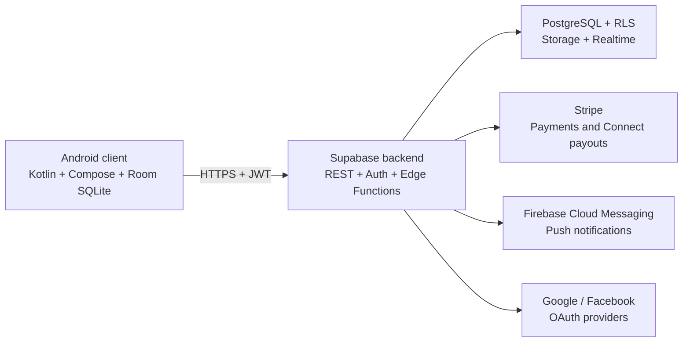
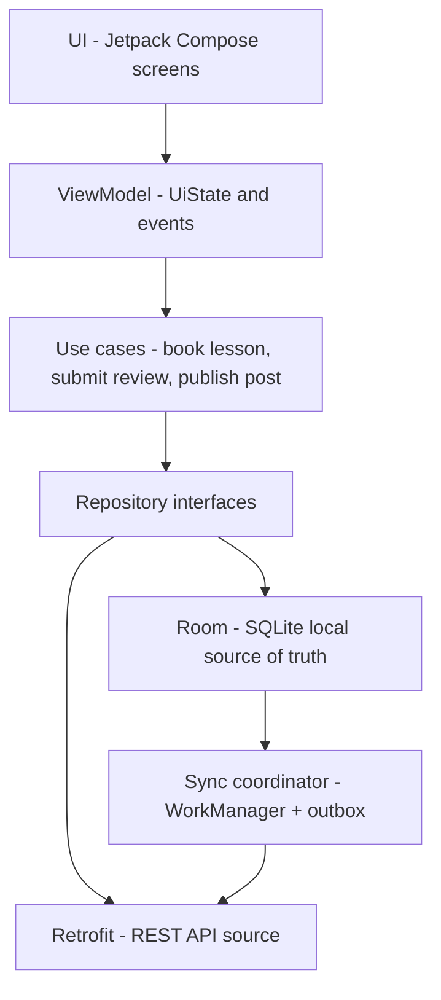
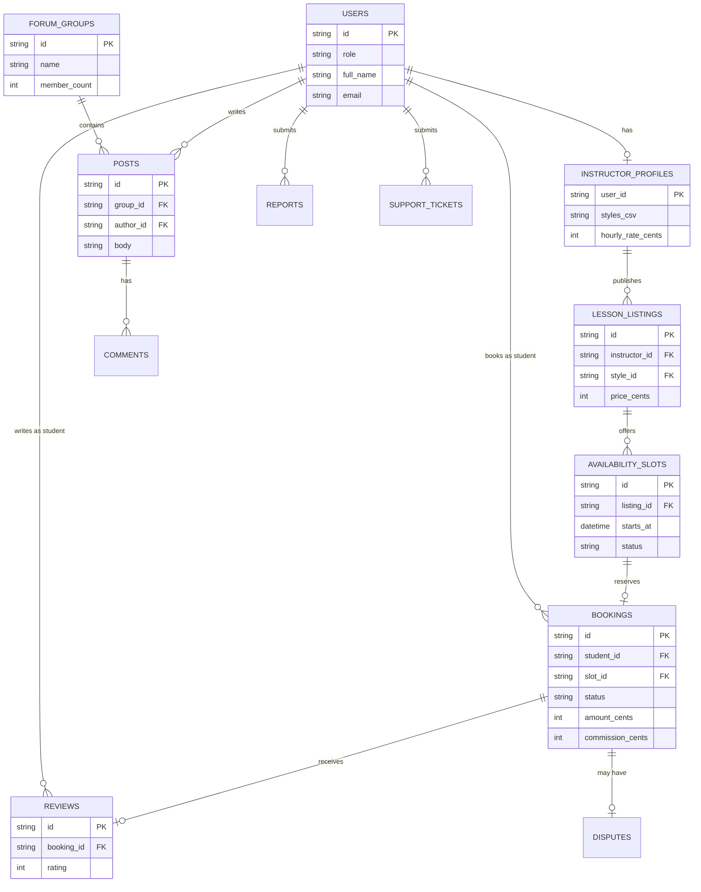
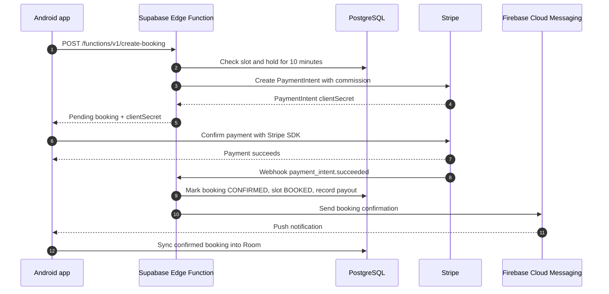

# MoMA — Android app design

**Project:** MoMA (Masters of Martial Arts)  
**Source brief:** `Assignments/Assignment2.pdf`  
**Platform:** Android Studio, Kotlin, SQLite (via Room)  
**Backend recommendation:** Supabase REST API + Edge Functions, with Stripe for payments  
**Document status:** Design proposal for implementation

---

## 1. Interpretation of the assignment

MoMA is a shared/gig-economy marketplace that connects martial arts instructors with students who want flexible, personalised training. Instructors monetise their expertise by choosing when and how they teach; students discover, book, pay for and review lessons.

The PDF defines the business model, target market, operations, financial projections, and 13 wireframe areas:

1. Authentication — register, login, forgot password
2. User profiles and portfolio
3. Listings and content management — category list, content detail
4. Search and discovery — search bar, autocomplete
5. Online forums and groups — group list, cards, discussion feed, post composer
6. Matching algorithm
7. Payments and transactions — checkout
8. Disputes
9. Ratings and reviews — 5-star rating, media composer
10. Dashboard analytics — training progress, app usage, custom widgets
11. Reporting — sales report, user/content reporting
12. Support page — feedback form, contact support
13. Mobile device accessibility

Revenue is commission-based (10–20% per lesson), with optional instructor subscriptions and targeted advertising.

**Target users:** students and hobbyists aged 18–55; freelance martial arts instructors; MoMA moderators/admins.

---

## 2. Product scope and roles

| Role | Primary goals | Key screens |
|---|---|---|
| Student | Discover instructors, compare styles and prices, book and pay, track progress, review lessons, join groups | Search, matching, instructor detail, checkout, bookings, dashboard, reviews, groups |
| Instructor | Publish lessons, manage availability, receive payouts, build reputation, subscribe to promotions | Profile/portfolio, content management, availability, bookings, sales report, payouts |
| Admin/moderator | Verify instructors, handle disputes and reports, moderate forums, monitor operations | Admin dashboard, report queue, dispute queue, user/content moderation |

### Recommended delivery phases

- **Phase 1 — MVP:** authentication, profiles, category/listing browse, search, instructor detail, booking, Stripe payment, reviews, support.
- **Phase 2:** matching algorithm, groups/forum, notifications, dashboard analytics.
- **Phase 3:** disputes, reporting, subscriptions, ads, admin console.
- **Phase 4:** hardening, accessibility, performance, Play Store release.

All 13 areas are designed below; the phasing only controls implementation order.

---

## 3. Recommended Android technology stack

| Concern | Choice | Reason |
|---|---|---|
| IDE / language | Android Studio + Kotlin | Native Android requirement; concise, safe, coroutine-friendly |
| UI | Jetpack Compose + Material 3 | Fast iteration on the provided card/list/dashboard wireframes; custom theme can adopt the green accent used in the PDF |
| Navigation | Navigation Compose | Single-activity, typed routes, deep links |
| Architecture | MVVM + Clean Architecture | Clear separation between UI, domain logic and data sources |
| Local database | **Room** over SQLite | Type-safe SQLite, migrations, `Flow` observables; satisfies the SQLite requirement without raw cursor boilerplate |
| Async | Coroutines + Flow | Lifecycle-aware async data streams |
| DI | Hilt | Testable repositories and ViewModels |
| HTTP | Retrofit + OkHttp + kotlinx.serialization | Clean REST client for Supabase/Edge Functions |
| Background work | WorkManager | Reliable offline write sync under network constraints |
| Secure storage | EncryptedSharedPreferences / Security-crypto, Android Keystore | JWT and refresh token protection |
| Images | Coil | Avatar, listing and review media loading |
| Maps/location | Google Maps SDK (optional) | Location-based instructor search; request only coarse location unless precise distance is needed |
| Payments | Stripe Android SDK | Client-side tokenisation; card data never touches MoMA SQLite |
| Push | Firebase Cloud Messaging | Booking, payment, dispute and forum notifications |
| Observability | Firebase Crashlytics + Analytics (optional) | Crash and usage monitoring |

**Suggested Gradle setup:** `minSdk 26`, `compileSdk`/`targetSdk` set to the latest stable Android SDK available in Android Studio, Kotlin 2.x, Compose BOM managed by Gradle version catalog.

---

## 4. Application architecture

### 4.1 System context



### 4.2 Layers



**Rules**

- The UI never talks directly to Room or Retrofit.
- Room is the local source of truth for screens; remote data is written into Room before being observed.
- Writes are queued in an `outbox` table when offline and replayed by WorkManager with idempotency keys.
- Bookings and payments are always server-authoritative; local state is displayed as pending until confirmed.
- Domain models are separate from Room entities and API DTOs.

### 4.3 Suggested Gradle modules

```text
:app                  navigation, theme, entry point
:core:model           User, Instructor, Lesson, Booking, Review, Post...
:core:common          Result, dispatcher, constants
:core:database        Room entities, DAOs, migrations, outbox
:core:network         Retrofit clients, DTOs, interceptors
:core:datastore       settings, session, secure token store
:feature:auth         register, login, forgot password
:feature:discovery    home, categories, search, matching, instructor detail
:feature:booking      availability, checkout, payment result, bookings
:feature:review       rating and review composer
:feature:forum        groups, posts, comments, composer
:feature:dashboard    training analytics, widgets
:feature:support      support, reports, disputes
:feature:admin        verification, moderation, payouts (phone/tablet)
```

---

## 5. Screens and navigation

### 5.1 Navigation model

Use a single `MainActivity` with a `NavHost`.

- **Unauthenticated graph:** Splash → Onboarding → Login → Register → Forgot password.
- **Authenticated graph:** Bottom navigation with **Home**, **Search**, **Bookings**, **Groups**, **Profile**.
- **Role-aware destinations:** Instructor dashboard and Admin console are reachable from Profile only when the role permits.
- **Modal/full-screen flows:** Instructor detail, matching results, checkout, payment result, review composer, dispute form, report form, support form.

### 5.2 Screen specifications

| # | Screen | Wireframe basis | Key UI elements | Behaviour |
|---|---|---|---|---|
| 1 | Register | PDF p.4 | Full name, phone, email, password, Google/Facebook buttons, "Already have an account? Login" | Validate fields, create Supabase Auth user, store JWT securely, create user profile |
| 2 | Login | PDF p.4 | Email, password with visibility toggle, forgot-password link, social login, register link | Sign in, restore session, navigate by role |
| 3 | Forgot password | PDF p.4 | Email, Reset password button | Call Supabase password recovery; show neutral success message |
| 4 | Profile / portfolio | PDF p.5 | Avatar, name, role badge, bio, styles, qualifications, ratings, portfolio media, Edit profile | Student sees own profile; instructor portfolio is public; edits sync via outbox |
| 5 | Category list | PDF p.6 | Search field, circular style tiles (Yoga, Gym, Cardio, Stretch, Full Body, Legs plus MoMA styles such as Judo, BJJ, Muay Thai) | Filter instructors/listings by style |
| 6 | Content management / instructor detail | PDF p.6 | Hero image, instructor name, price, description, availability, book CTA | Instructor can edit listing; student can open slot picker |
| 7 | Search and discovery | PDF p.7 | Search bar, autocomplete suggestions, filter chips (style, city, price, rating, availability) | Debounced search; online results cached into Room |
| 8 | Matching | PDF p.9 | Preference inputs (style, level, goals, city, budget, schedule), ranked instructor cards | `POST /functions/v1/match-instructors`; explain score factors |
| 9 | Checkout | PDF p.9 | 4-step progress: Lesson → Slot → Payment → Review; payment method, billing address, continue | Stripe PaymentIntent; server creates pending booking; confirm after payment |
| 10 | Bookings | Derived | Upcoming/past/completed tabs, status chips, lesson details, pay/cancel/reschedule/dispute/review actions | Reads from Room; live status from API |
| 11 | Rating and review | PDF p.10 | 5-star rating, quick tags (easy to use, helpful, convenient, etc.), text/media composer, submit | Only students of completed bookings can submit; media uploads to Storage |
| 12 | Dispute | PDF p.10 heading | Booking reference, reason, details, evidence upload, submit | Creates dispute ticket; blocks review until resolved if required |
| 13 | Groups | PDF p.8 | Suggested groups, "Your groups", "Groups near you", join buttons, create group | Join/leave, open group feed |
| 14 | Group feed and composer | PDF p.8 | Post list with like/comment/share, text/media composer, rules and member list | Create posts/comments/likes; optimistic local drafts |
| 15 | Dashboard analytics | PDF p.11 | Today/Week/Month tabs; cards for sessions, duration, intensity, calories/steps-style widgets; custom widget order | Student progress + instructor performance; charts from analytics API |
| 16 | Sales report | PDF p.12 | Sales performance rings, lead optimisation bars, bookings chart, period tabs | Instructor/admin view; server-generated aggregates |
| 17 | User/content reporting | PDF p.12 | Reasons: spam, hate speech, false information, adult content, violence, IP violation, other; details, submit | Creates report with target type/id |
| 18 | Support | PDF p.13 | Subject, issue, image upload, email, phone, submit; email/phone/chat contacts | Creates support ticket; offline draft queued |
| 19 | Admin console | Derived from Operations | Verification queue, disputes, reports, payouts, content moderation | Role-protected; admin-only API claims/RLS |

### 5.3 Visual direction

- Keep the wireframe-friendly light theme with a green primary accent from the PDF mockups.
- Use Material 3 cards, 12–16 dp corner radius, generous spacing, and status chips.
- Bottom navigation labels: Home, Search, Bookings, Groups, Profile.
- Provide large touch targets (minimum 48 dp), content scaling support, and TalkBack labels.

---

## 6. SQLite / Room data model

Room is the SQLite layer. The server database remains authoritative; local tables mirror only what the app needs.

### 6.1 Core entities

| Table | Important columns | Notes |
|---|---|---|
| `users` | `id` PK, `role` (`STUDENT`/`INSTRUCTOR`/`ADMIN`), `full_name`, `email`, `phone`, `avatar_url`, `city`, `updated_at`, `sync_status` | No password stored locally |
| `instructor_profiles` | `user_id` PK/FK, `bio`, `styles_csv`, `experience_years`, `qualifications`, `hourly_rate_cents`, `rating_avg`, `review_count`, `verified`, `lat`, `lng` | One-to-one with user |
| `martial_art_styles` | `id` PK, `name`, `icon_url`, `sort_order` | Cached catalogue |
| `lesson_listings` | `id` PK, `instructor_id` FK, `style_id` FK, `title`, `description`, `level`, `duration_min`, `price_cents`, `city`, `lat`, `lng`, `active` | Instructor offer |
| `availability_slots` | `id` PK, `listing_id` FK, `starts_at`, `ends_at`, `status`, `version` | Status: FREE, HELD, BOOKED |
| `bookings` | `id` PK, `student_id`, `instructor_id`, `listing_id`, `slot_id`, `status`, `amount_cents`, `commission_cents`, `currency`, `payment_intent_id`, `starts_at`, `sync_status` | PENDING_PAYMENT → CONFIRMED → COMPLETED/CANCELLED/DISPUTED |
| `payments` | `id` PK, `booking_id` FK, `provider`, `provider_payment_id`, `amount_cents`, `status`, `paid_at` | Never store PAN/CVV |
| `payouts` | `id` PK, `instructor_id`, `booking_id`, `gross_cents`, `fee_cents`, `net_cents`, `status` | Mirrors Stripe Connect transfers |
| `reviews` | `id` PK, `booking_id` FK UNIQUE, `instructor_id`, `student_id`, `rating`, `title`, `body`, `created_at`, `sync_status` | Rating 1–5 |
| `review_media` | `id` PK, `review_id` FK, `local_uri`, `remote_url`, `media_type`, `upload_state` | IMAGE/VIDEO |
| `forum_groups` | `id` PK, `name`, `description`, `rules`, `member_count`, `joined` | Cached group metadata |
| `group_members` | `group_id`, `user_id`, `role`, PRIMARY KEY (`group_id`, `user_id`) | Group membership |
| `posts` | `id` PK, `group_id` FK, `author_id`, `body`, `media_urls_csv`, `like_count`, `comment_count`, `created_at`, `sync_status` | Discussion feed |
| `comments` | `id` PK, `post_id` FK, `author_id`, `body`, `created_at`, `sync_status` | Post comments |
| `post_likes` | `post_id`, `user_id`, PRIMARY KEY (`post_id`, `user_id`) | Like state |
| `reports` | `id` PK, `reporter_id`, `target_type`, `target_id`, `reason`, `details`, `status`, `sync_status` | Spam, hate speech, etc. |
| `disputes` | `id` PK, `booking_id` FK, `raised_by`, `reason`, `details`, `evidence_urls_csv`, `status` | Open/under review/resolved |
| `support_tickets` | `id` PK, `subject`, `issue`, `image_uri`, `email`, `phone`, `status`, `sync_status` | Support form draft/final |
| `notifications` | `id` PK, `type`, `title`, `body`, `deep_link`, `read`, `created_at` | Local notification inbox |
| `analytics_events` | `id` PK, `event_type`, `entity_id`, `value_json`, `occurred_at`, `synced` | Offline usage queue |
| `dashboard_widgets` | `id` PK, `user_id`, `widget_type`, `position`, `enabled` | Custom dashboard layout |
| `outbox` | `id` PK, `entity`, `entity_id`, `operation`, `payload_json`, `idempotency_key`, `retry_count`, `created_at` | Offline write queue |

Simplified core relationships:



### 6.2 Indexes and integrity

- Index `bookings(student_id, starts_at)`, `bookings(instructor_id, status)`, `availability_slots(listing_id, starts_at)`, `posts(group_id, created_at)`, `reviews(instructor_id, rating)`.
- Enable `PRAGMA foreign_keys = ON`.
- Use `version` or `updated_at` for conflict detection.
- Use migrations (`Migration(1, 2)`, etc.) from the first release; never rely on destructive migration.

### 6.3 Illustrative Room code

```kotlin
@Entity(tableName = "bookings")
data class BookingEntity(
    @PrimaryKey val id: String,
    val studentId: String,
    val instructorId: String,
    val listingId: String,
    val slotId: String,
    val status: String,
    val amountCents: Int,
    val commissionCents: Int,
    val currency: String = "MYR",
    val paymentIntentId: String? = null,
    val startsAt: String,
    val updatedAt: String,
    val syncStatus: String = "SYNCED"
)

@Dao
interface BookingDao {
    @Query("SELECT * FROM bookings WHERE studentId = :studentId ORDER BY startsAt DESC")
    fun observeForStudent(studentId: String): Flow<List<BookingEntity>>

    @Query("SELECT * FROM bookings WHERE syncStatus = 'PENDING'")
    suspend fun pending(): List<BookingEntity>

    @Upsert
    suspend fun upsertAll(bookings: List<BookingEntity>)

    @Update
    suspend fun update(booking: BookingEntity)
}
```

```kotlin
interface MoMApi {
    @POST("functions/v1/create-booking")
    suspend fun createBooking(@Body request: CreateBookingRequest): CreateBookingResponse

    @POST("functions/v1/confirm-booking")
    suspend fun confirmBooking(@Body request: ConfirmBookingRequest): BookingDto

    @POST("functions/v1/match-instructors")
    suspend fun match(@Body request: MatchRequest): List<InstructorMatchDto>

    @GET("rest/v1/bookings")
    suspend fun bookings(@Query("student_id") studentId: String): List<BookingDto>
}
```

### 6.4 Offline behaviour

| Operation | Offline behaviour |
|---|---|
| Browse cached listings/profiles/groups | Allowed; show "Showing saved data" banner |
| Search/autocomplete | Requires network; show last results if available |
| Edit profile/post/review/support/report | Saved locally and queued in `outbox` |
| Book/pay | Requires network; no offline payment authorisation |
| Review media upload | Queued locally; upload retried by WorkManager |
| Conflict | Server wins for bookings/payments; field-level last-write-wins for profile/post text |

---

## 7. Backend API recommendation

### 7.1 Recommended backend: Supabase

Use **Supabase** as the backend platform:

- **PostgreSQL** for relational data (users, listings, slots, bookings, reviews, forum, reports).
- **Auth (GoTrue)** for email/password, Google and Facebook sign-in, password reset, JWT sessions.
- **PostgREST** for generated REST endpoints with row-level security.
- **Storage** for avatars, listing images, review photos/videos and dispute evidence.
- **Edge Functions** for business logic that must be trusted: matching score, booking creation, Stripe PaymentIntent, commission calculation, payouts, notifications, analytics aggregation.
- **Realtime** (optional) for live forum/thread updates.

**Why this fits MoMA**

- Relational model matches instructors → listings → slots → bookings → reviews → payouts.
- Android can call standard HTTPS REST endpoints from Kotlin/Retrofit; no custom server to operate for the assignment.
- RLS gives per-user and per-role data isolation.
- Edge Functions keep Stripe secret keys and commission logic off the device.
- PostgreSQL supports the sales/bookings reports required by the wireframes.

**Alternatives considered**

| Option | Strength | Why not primary |
|---|---|---|
| Firebase Auth + Firestore + Functions | Excellent mobile SDKs and realtime | Denormalised data makes bookings, availability and relational reports harder |
| Custom Ktor/NestJS + PostgreSQL REST API | Full control | Highest implementation and ops effort |
| Supabase | Relational + auth + storage + serverless logic | Selected |

### 7.2 API bases and auth

```text
Supabase Auth:     https://<PROJECT>.supabase.co/auth/v1
REST data:         https://<PROJECT>.supabase.co/rest/v1
Edge Functions:    https://<PROJECT>.supabase.co/functions/v1
Storage:           https://<PROJECT>.supabase.co/storage/v1
```

Headers for authenticated calls:

```text
Authorization: Bearer <access_token>
apikey: <SUPABASE_ANON_PUBLIC_KEY>
Content-Type: application/json
```

The anon/public key is safe to ship in the app; **RLS is the security boundary**. The service-role key must exist only in Edge Functions/environment variables and never in Android code.

### 7.3 Endpoint catalogue

| Method | Path | Purpose | Auth |
|---|---|---|---|
| POST | `/auth/v1/signup` | Register with email/password | Public |
| POST | `/auth/v1/token?grant_type=password` | Login | Public |
| POST | `/auth/v1/recover` | Forgot password | Public |
| GET | `/auth/v1/user` | Current user | Bearer |
| GET | `/rest/v1/users?id=eq.<uid>` | Own profile | Bearer + RLS |
| PATCH | `/rest/v1/users?id=eq.<uid>` | Update own profile | Bearer + RLS |
| GET | `/rest/v1/instructor_profiles` | Browse instructors | Bearer/RLS |
| PATCH | `/rest/v1/instructor_profiles?user_id=eq.<uid>` | Instructor edits portfolio | Instructor + RLS |
| GET | `/rest/v1/martial_art_styles` | Style catalogue | Public |
| GET | `/rest/v1/lesson_listings` | Filter listings by style/city/level | Public/RLS |
| POST | `/rest/v1/lesson_listings` | Create lesson listing | Instructor + RLS |
| PATCH | `/rest/v1/lesson_listings?id=eq.<id>` | Edit listing | Owner + RLS |
| GET | `/rest/v1/availability_slot?listing_id=eq.<id>&starts_at=gte.<ts>` | Slots for listing | Public/RLS |
| GET | `/functions/v1/search?q=&lat=&lng=&style=&from=&to=` | Search and autocomplete | Bearer |
| POST | `/functions/v1/match-instructors` | Rank instructors by preferences | Bearer |
| POST | `/functions/v1/create-booking` | Create pending booking + Stripe PaymentIntent | Student |
| POST | `/functions/v1/confirm-booking` | Confirm after successful payment | Student/server |
| GET | `/rest/v1/bookings?student_id=eq.<uid>` | Student bookings | Student/RLS |
| GET | `/rest/v1/bookings?instructor_id=eq.<uid>` | Instructor bookings | Instructor/RLS |
| POST | `/functions/v1/cancel-booking` | Cancel with policy/refund rules | Involved user |
| GET | `/rest/v1/reviews?instructor_id=eq.<id>` | Instructor reviews | Public/RLS |
| POST | `/rest/v1/reviews` | Submit review for completed booking | Student + RLS |
| GET | `/rest/v1/forum_groups` | Group list | Public/RLS |
| POST | `/rest/v1/group_members` | Join group | Bearer + RLS |
| GET | `/rest/v1/posts?group_id=eq.<id>` | Group feed | Member/RLS |
| POST | `/rest/v1/posts` | Create post | Member + RLS |
| POST | `/rest/v1/comments` | Comment on post | Member + RLS |
| POST | `/rest/v1/post_likes` | Like post | Member + RLS |
| POST | `/rest/v1/reports` | Report user/content | Bearer + RLS |
| POST | `/rest/v1/disputes` | Raise booking dispute | Involved user |
| GET | `/rest/v1/disputes?raised_by=eq.<uid>` | My disputes | Bearer + RLS |
| POST | `/rest/v1/support_tickets` | Submit support ticket | Bearer/guest |
| GET | `/functions/v1/analytics/dashboard?range=week` | Student/instructor dashboard data | Bearer |
| GET | `/functions/v1/reports/sales?from=&to=` | Instructor/admin sales report | Instructor/admin |
| POST | `/storage/v1/object/avatars/<uid>/<file>` | Upload avatar | Bearer + RLS |
| POST | `/storage/v1/object/review-media/<uid>/<file>` | Upload review media | Bearer + RLS |
| POST | `/functions/v1/notify` | Send FCM notification | Server/admin |

### 7.4 Key contracts

**Create booking — request**

```json
{
  "listingId": "lst_123",
  "slotId": "slot_456",
  "paymentMethodId": "pm_..."
}
```

**Create booking — response**

```json
{
  "bookingId": "bk_789",
  "status": "PENDING_PAYMENT",
  "amountCents": 12000,
  "commissionCents": 1800,
  "currency": "MYR",
  "paymentIntent": {
    "id": "pi_...",
    "clientSecret": "pi_..._secret_..."
  }
}
```

**Confirm booking — request**

```json
{
  "bookingId": "bk_789",
  "paymentIntentId": "pi_..."
}
```

**Confirm booking — response**

```json
{
  "bookingId": "bk_789",
  "status": "CONFIRMED",
  "slotStatus": "BOOKED",
  "receiptUrl": "https://..."
}
```

**Matching — request**

```json
{
  "style": "Brazilian Jiu-Jitsu",
  "level": "BEGINNER",
  "city": "Johor Bahru",
  "budgetCentsMax": 15000,
  "preferredDays": ["SAT", "SUN"],
  "goal": "FITNESS"
}
```

**Matching score factors (server-side, documented in UI)**

- Style match: 30%
- Availability overlap: 25%
- Distance: 15%
- Rating/review quality: 15%
- Price fit: 10%
- Verification/response rate: 5%

**Error envelope**

```json
{
  "error": {
    "code": "SLOT_NO_LONGER_AVAILABLE",
    "message": "This time slot was just booked.",
    "traceId": "req_abc123"
  }
}
```

Use HTTP `400` validation, `401` unauthenticated, `403` forbidden, `404` missing, `409` conflict, `422` business-rule failure, `429` rate limit, `500` unexpected.

### 7.5 Server-side business rules

- Booking creation checks slot availability atomically in a PostgreSQL transaction, sets `HELD`, creates a Stripe PaymentIntent with `application_fee_amount` equal to the 10–20% commission, and expires the hold after 10 minutes.
- Payment confirmation verifies the Stripe webhook/event, marks the booking `CONFIRMED`, marks the slot `BOOKED`, and schedules a payout to the instructor's Stripe Connect account.
- Cancellation/refund policy is enforced server-side; clients cannot modify payment or booking status directly.
- Reviews require a `COMPLETED` booking for the same student/instructor pair.
- Instructor subscription status controls promoted placement and advanced analytics.
- Commission rate is resolved from instructor level/plan; it is calculated on the server and returned to the app.

### 7.6 Booking and payment sequence



---

## 8. Security, privacy and compliance

- Store access/refresh tokens in Android Keystore-backed storage; clear on logout.
- Use HTTPS only; consider certificate pinning for production.
- RLS examples:
  - Users read/update only their own row; instructors update only their own portfolio/listings.
  - Students read only their bookings; instructors read bookings where they are the instructor.
  - Only the booking's student can insert a review for that booking.
  - Reports/disputes readable by reporter/raised-by user and admins only.
  - Payment/payout tables are not directly client-writable.
- Never store card numbers, CVV, Stripe secret keys or service-role keys on the device.
- Upload validation: allowlisted MIME types, max size (e.g. 10 MB image, 100 MB video), server-side re-scanning.
- Request runtime permissions only when needed: camera/storage for media, notifications for FCM, coarse location for nearby search.
- Malaysia PDPA alignment: collect only required data, show a privacy notice at registration, support account/data deletion requests, define retention for tickets and disputes.
- Add report/moderation flows for forum safety and instructor verification before payouts.

---

## 9. Testing and quality plan

| Level | Tests |
|---|---|
| Unit | ViewModels, use cases, matching score formatter, price/commission calculations |
| Room | DAO queries, migrations, foreign keys, outbox replay |
| Network | Retrofit contract tests with MockWebServer; error mapping |
| Compose UI | Navigation, form validation, critical screen snapshots |
| Integration | Mock Supabase + Stripe test mode for booking flow |
| End-to-end | Maestro scripts: register → search → book → pay → review; join group → post → comment |
| Non-functional | Accessibility scanner, TalkBack labels, low-network/offline test, leak detection |

---

## 10. Implementation roadmap

1. **Project setup:** Gradle version catalog, modules, theme, navigation skeleton, Hilt, Room, Retrofit.
2. **Auth + profile:** register/login/reset, session restore, profile CRUD, secure token store.
3. **Discovery:** category list, listings, search/autocomplete, instructor detail, Room cache.
4. **Booking + payment:** availability, create/payment/confirm booking, Stripe test mode, booking list.
5. **Trust layer:** reviews, disputes, reports, support tickets, moderation states.
6. **Community:** groups, feed, composer, comments, likes, FCM.
7. **Insights:** dashboard widgets, analytics API, sales report.
8. **Hardening:** offline sync, error states, accessibility, testing, Play Store release checklist.

---

## 11. Acceptance criteria for the Android client

- A new user can register, log out, reset a password and restore a session after restart.
- An instructor can publish a lesson and define availability slots that appear in student search.
- A student can search/filter, open an instructor, select a slot, pay with Stripe test card and see a confirmed booking.
- A completed booking can be rated once with text and optional media.
- Reports, disputes and support tickets can be submitted offline and sync when connectivity returns.
- Forum posts/comments/likes work with role-aware access and optimistic UI.
- Dashboard widgets can be toggled/reordered and show Today/Week/Month ranges.
- No payment secrets or other users' private data are stored in SQLite.
